# 🫁 CheXNet Hybrid AI — Hệ Thống Hỗ Trợ Phân Tích Ảnh X-Quang Lồng Ngực

[](https://www.python.org/)
[](https://pytorch.org/)
[](https://fastapi.tiangolo.com/)
[](https://expressjs.com/)
[](https://react.dev/)
[](https://github.com/ultralytics/ultralytics)

**CheXNet Hybrid AI** là hệ thống nghiên cứu **CADx (Computer-Aided Diagnosis)** hỗ trợ phân tích ảnh X-quang ngực, kết hợp mô hình phân loại đa nhãn **Hybrid CNN–ViT (`ConvNeXtV2` + `SwinV2`)** cho **15 nhãn lớp** (14 bệnh lý/dấu hiệu phổi + `No Finding`) với bộ định vị tổn thương **YOLO11m** (`14` lớp VinDr-CXR), cơ chế **FPN Grad-CAM / Attention fallback** cho các bệnh YOLO chưa phủ, cùng nền tảng web 3 lớp (React 19 + Express TypeScript Gateway + FastAPI AI Service).

---

## 📑 Mục Lục

- [🌟 Đặc Điểm Thực Tế Của Hệ Thống](#-đặc-điểm-thực-tế-của-hệ-thống)
- [🏗️ Kiến Trúc Tổng Thể](#️-kiến-trúc-tổng-thể)
  - [1. Sơ Đồ Luồng Web Full-Stack](#1-sơ-đồ-luồng-web-full-stack)
  - [2. Mô Hình Phân Loại Hybrid (`Models/Model.py`)](#2-mô-hình-phân-loại-hybrid-modelsmodelpy)
  - [3. Bộ Định Vị YOLO11m & Cơ Chế Bổ Sung Từ Hybrid](#3-bộ-định-vị-yolo11m--cơ-chế-bổ-sung-từ-hybrid)
  - [4. Khối Phân Tích Lâm Sàng & Tra Cứu Ca Tương Tự](#4-khối-phân-tích-lâm-sàng--tra-cứu-ca-tương-tự)
- [🎓 Quy Trình Huấn Luyện & Tinh Chỉnh](#-quy-trình-huấn-luyện--tinh-chỉnh)
- [💻 Ngăn Xếp Công Nghệ Thực Tế](#-ngăn-xếp-công-nghệ-thực-tế)
- [📂 Cấu Trúc Thư Mục Dự Án](#-cấu-trúc-thư-mục-dự-án)
- [📊 Số Liệu Phần Cứng, Checkpoint & Đánh Giá Thực Nghiệm](#-số-liệu-phần-cứng-checkpoint--đánh-giá-thực-nghiệm)
- [🚀 Hướng Dẫn Cài Đặt, Khởi Chạy & Kiểm Thử](#-hướng-dẫn-cài-đặt-khởi-chạy--kiểm-thử)
- [📚 Danh Mục Bệnh Lý Nhận Diện](#-danh-mục-bệnh-lý-nhận-diện)
- [⚖️ Tuyên Bố Miễn Trừ Trách Nhiệm Y Tế](#️-tuyên-bố-miễn-trừ-trách-nhiệm-y-tế)

---

## 🌟 Đặc Điểm Thực Tế Của Hệ Thống

1. **Phân loại đa nhãn Hybrid CNN–ViT (`HybridCNNViTModel`)**:
   - Kết hợp nhánh cục bộ `ConvNeXtV2` và stage cuối của nhánh toàn cục `SwinV2` với `FPN` decoder, `15-Channel Attention Head` và cơ chế `Per-Class Residual Channel Gating` (`α = Sigmoid(θ_gate) × 0.8`).
   - Trên web (`/v3/predict`), kết quả trả về **đủ 15 xác suất** cùng quyết định vượt ngưỡng và cảnh báo xung đột `No Finding`; JPEG heatmap chỉ kết xuất cho tối đa 6 nhãn dương tính xác suất cao nhất, nhưng mọi nhãn dương tính từ vị trí thứ 7 trở đi vẫn được giữ nguyên trong danh sách chẩn đoán, báo cáo PDF và fallback bbox.

2. **Định vị đa nguồn minh bạch (YOLO11m + Hybrid Fallback)**:
   - Chạy song song `YOLODetector` (`Trainedmodel/yolov11m.pt`, `imgsz=1024`, `conf=0.15`, lọc Cascade `P_cls × Conf_YOLO`) cho `14` lớp VinDr-CXR.
   - Do tập VinDr-CXR chỉ trùng một phần nhãn với NIH14 (không có `Pneumonia`, `Edema`, `Emphysema`, `Hernia`), `Backend/main.py` trích xuất thêm `hybrid_boxes` (chiếu về tọa độ ảnh gốc) cho các bệnh vượt ngưỡng chưa có YOLO box bằng **FPN Grad-CAM** (`model.fpn_merge`) hoặc **Attention Map** (lọc phổi + fallback thô).
   - Trên trình xem `XrayViewer` (một khung ảnh duy nhất), `yolo_detections` và `hybrid_boxes` được tách biệt: mặc định chỉ hiển thị khung của **bệnh có xác suất cao nhất**, khi bác sĩ chọn bệnh nào mới hiển thị khung và bản đồ chú ý của bệnh đó.

3. **Kiểm soát đầu vào, truy vết và lưu trữ an toàn**:
   - Hỗ trợ JPEG, PNG và DICOM đơn khung thang độ xám (`pydicom 3.0.1`: `MONOCHROME1/2`, áp dụng `Modality LUT` / `VOI LUT`, gỡ toàn bộ metadata DICOM trước khi tạo `preview.png`).
   - Bộ kiểm định `ClipChestXRayValidator` (`open-clip-torch` `ViT-B-32` + kiểm tra phân bố màu) chặn ảnh không phải X-quang ngực ở `/v3/predict`.
   - `ModelCallTrace` gắn PyTorch forward hook trực tiếp lên `hybrid` và `yolo` để ghi vết thực thi thật (`traceId`, `forwardCalls`, shape, thời gian) vào `.runtime/inference-audit.log`, lưu MongoDB và in vào phiếu PDF.

4. **Quản lý ca bệnh & báo cáo quy tắc (không dùng LLM ngoài)**:
   - Node.js/Express TypeScript Gateway (`Backend/src/`) cung cấp xác thực JWT + RBAC (`admin`, `doctor`, `user`), quản lý bệnh nhân, tải ảnh bất đồng bộ có `Idempotency-Key`, Socket.IO thông báo hoàn tất (`scan:completed`), xác minh phiếu với khóa lạc quan `revision` (`HTTP 409`), thống kê nghiên cứu và xuất CSV UTF-8 BOM / PDF ReportLab tiếng Việt.
   - Báo cáo lâm sàng được sinh từ bộ quy tắc [`Backend/report_generator.py`](Backend/report_generator.py) và ma trận tương quan `15×15` tại [`Backend/post_processing.py`](Backend/post_processing.py). **Dự án không tích hợp Google Gemini hay bất kỳ dịch vụ LLM bên ngoài nào.**

---

## 🏗️ Kiến Trúc Tổng Thể

### 1. Sơ Đồ Luồng Web Full-Stack

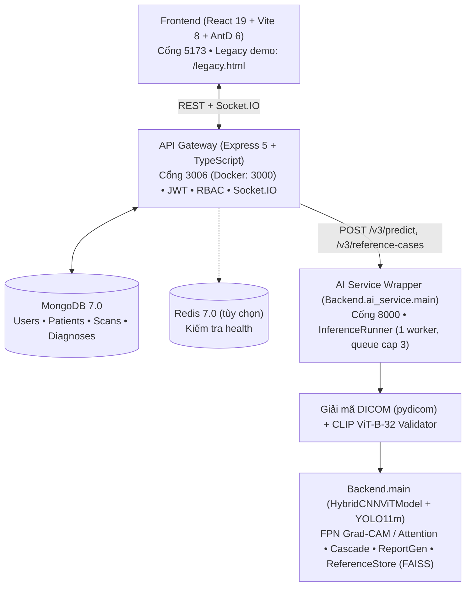

### 2. Mô Hình Phân Loại Hybrid (`Models/Model.py`)

Kiến trúc `HybridCNNViTModel` hỗ trợ hai cấu hình `base` và `large` (độ phân giải mặc định `384×384`):

| Thành phần | Cấu hình `base` (`125,263,967` params) | Cấu hình `large` (`279,118,207` params) | Đầu ra tại `384×384` |
|:---|:---|:---|:---|
| CNN Backbone | `convnextv2_base.fcmae_ft_in22k_in1k_384` | `convnextv2_large.fcmae_ft_in22k_in1k_384` | Stage 3: `[B, 512/768, 24, 24]`; Stage 4: `[B, 1024/1536, 12, 12]` |
| ViT Branch | `swinv2_base_window12to16_192to256.ms_in22k_ft_in1k` (chỉ `layers[-1]`) | `swinv2_large_window12to16_192to256.ms_in22k_ft_in1k` (chỉ `layers[-1]`) | `[B, 1024/1536, 12, 12]` |
| FPN Decoder | `Conv1x1` Stage 3 + `Upsample(2×)` ViT -> `Conv3x3 + BN + GELU` | `Conv1x1` Stage 3 + `Upsample(2×)` ViT -> `Conv3x3 + BN + GELU` | `[B, 1024/1536, 24, 24]` |
| Attention Head | `Conv3x3(->256) + BN + GELU + Conv1x1(->15) + Sigmoid` | `Conv3x3(->256) + BN + GELU + Conv1x1(->15) + Sigmoid` | `[B, 15, 24, 24]` |
| Channel Gating | Chia 15 nhóm (`14×68 + 1×72`), `α ∈ [0, 0.8]` | Chia 15 nhóm (`14×102 + 1×108`), `α ∈ [0, 0.8]` | `[B, 1024/1536, 12, 12]` |
| Embedding & Head | GAP thô `[B, 1024]` + Linear `15` (5× MSD lúc train) | GAP thô `[B, 1536]` + Linear `15` (5× MSD lúc train) | Logits `[B, 15]` + `pooled` (chưa chuẩn hóa L2) |

### 3. Bộ Định Vị YOLO11m & Cơ Chế Bổ Sung Từ Hybrid

- **Nhánh YOLO11m (`Backend/yolo_detector.py`)**:
  - Mô hình `YOLO11m` (`20,063,802` tham số) chạy ở `imgsz=1024`, `conf=0.15`, phát hiện **14 lớp VinDr-CXR**: `Aortic enlargement`, `Atelectasis`, `Calcification`, `Cardiomegaly`, `Consolidation`, `ILD`, `Infiltration`, `Lung Opacity`, `Nodule/Mass`, `Other lesion`, `Pleural effusion`, `Pleural thickening`, `Pneumothorax`, `Pulmonary fibrosis`.
  - Ánh xạ sang khóa CheXNet qua `VINDR_TO_CHEXNET` (`Nodule/Mass -> Mass`, `Pleural effusion -> Effusion`, `Pulmonary fibrosis -> Fibrosis`, `Pleural thickening -> Pleural_Thickening`; 5 lớp riêng của VinDr giữ nguyên tên gốc).
  - Bộ lọc Cascade (`P_CheXNet × Conf_YOLO`): `Pneumothorax: 0.05`, `Cardiomegaly: 0.10`, `Effusion: 0.10`, `Consolidation: 0.12`, các lớp khác `0.15` (lớp không có trong CheXNet dùng `Conf_YOLO >= 0.15`).
- **Nhánh Fallback Từ Hybrid (`Backend/main.py`)**:
  - Đối với mọi bệnh dương tính chưa có YOLO box, `_select_hybrid_localization` chọn **FPN Grad-CAM** trên `model.fpn_merge` (cho `Pneumonia`, `Edema`, `Emphysema`, `Hernia` hoặc khi attention không sinh được box) hoặc `attention_head` đã lọc mặt nạ phổi (fallback sang attention thô nếu mask triệt tiêu tín hiệu), sau đó `_collect_hybrid_fallback_boxes` chiếu tọa độ từ `CenterCrop(384)` về ảnh gốc và lọc nhiễu (`>= 0.2%` diện tích ảnh, tối đa 2 khung/bệnh).
- **Trực quan hóa**:
  - Trên Web UI (`XrayViewer.tsx`): Chế độ khung chỉ vẽ khung của **dấu hiệu đang chọn** (mặc định bệnh xác suất cao nhất), phân biệt YOLO (xanh `#58d6a4`, nét liền) và Hybrid (vàng cam `#f59e0b`, nét đứt).
  - Trên CLI (`run_predict.py`, mặc định dùng `hybrid_model.pth`): Xuất `_bbox.png`, `_fusion.png` (trộn Attention Map vào vùng trong box YOLO) và `_predict.png` (không tạo `hybrid_boxes` từ Grad-CAM như endpoint FastAPI).

### 4. Khối Phân Tích Lâm Sàng & Tra Cứu Ca Tương Tự

- **Phân vùng phổi cổ điển (`Backend/lung_segmentation.py`)**: CLAHE + Gaussian Blur `5×5` + Otsu nghịch đảo + đóng/mở hình thái học (bỏ qua mask đối với `Cardiomegaly`, `Hernia`, `No Finding`), ước tính 6 vùng giải phẫu (`Đỉnh phổi`, `Thùy trên`, `Thùy giữa / rốn phổi`, `Thùy dưới`, `Góc sườn hoành` trái/phải).
- **Ma trận đồng xuất hiện & Báo cáo (`Backend/post_processing.py`, `Backend/report_generator.py`)**: Bảng tương quan Pearson `15×15` tính từ `107,880` ảnh tập train + template khuyến nghị lâm sàng tiếng Việt, xuất PDF A4 qua `Backend/ai_service/report_pdf.py` (ReportLab).
- **CBIR Vector Search (`Backend/cbir.py`, `Backend/ai_service/reference_store.py`)**: FAISS `IndexFlatIP(1536)` chuẩn hóa vector `pooled` theo L2 tại thời điểm đánh chỉ mục/truy vấn. `ReferenceStore` bọc thêm khóa liên tiến trình (`writer.lock`) và cơ chế xuất bản atomic theo thế hệ (`Backend/data/reference-generations/`) có dự phòng tự động về thế hệ trước nếu lỗi đĩa. *(Mặc định kho cục bộ khởi tạo rỗng vì chưa có `chest_xray.faiss` sẵn trong repo.)*

---

## 🎓 Quy Trình Huấn Luyện & Tinh Chỉnh

### Dữ Liệu Phân Chia Trong Repo (`Dataset/*.csv`)

Tổng hợp từ 2 nguồn `NIH ChestX-ray 14` và `VinDr-CXR` (`166,226` dòng nhãn/bbox cho **`126,884` ảnh duy nhất**, `22,279` GT BBox từ VinDr):

| Tập chia | Tổng ảnh duy nhất | Ảnh NIH | Ảnh VinDr-CXR | Tổng dòng CSV |
|:---|---:|---:|---:|---:|
| `train_list.csv` | `107,880` | `95,332` | `12,548` | `141,279` |
| `val_list.csv` | `6,577` | `5,838` | `739` | `8,506` |
| `test_list.csv` | `12,427` | `10,950` | `1,477` | `16,441` |

*(5 lớp `No Finding`, `Pneumonia`, `Edema`, `Emphysema`, `Hernia` có `0` GT Bounding Box trong bộ dữ liệu kết hợp — nguồn: [`Results/Comparison/dataset_balance_audit.csv`](Results/Comparison/dataset_balance_audit.csv)).*

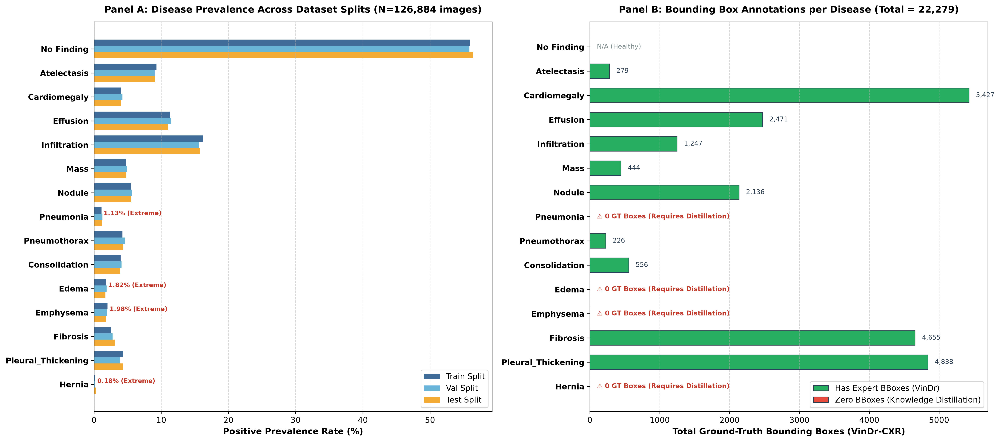

### A. Huấn Luyện Mô Hình Hybrid (`Models/TrainModel.py`)

- **Đọc & Augmentation (`Models/read_data.py`)**: Cache byte nén thô trong RAM (`bytes_cache`), gộp nhãn bác sĩ VinDr bằng phép `OR`, biến đổi hình học đồng bộ tensor 18 kênh (`3 ảnh + 15 mặt nạ`).
- **Giai đoạn 1 (Warm-up Attention trên tập train VinDr-CXR — 12,548 ảnh)**: `DiceLoss` tính trên các kênh có GT BBox qua `valid_mask`. `backbone_lr = 1e-4`, `head_lr = 5e-4`, `LinearLR` (3 epoch) + `CosineAnnealingLR`. Chuyển Giai đoạn 2 khi `Dice Loss < 0.65` và `Val AUROC > 0.68` trong `2` epoch liên tiếp.
- **Giai đoạn 2 (Hybrid VinDr + NIH tỉ lệ 1:3)**: Dùng `HybridBatchSampler` (25% VinDr / 75% NIH mỗi batch), thêm `ColorJitter(0.15, 0.15)` + `GaussianBlur`, hạ `LR` xuống `backbone = 8e-5` (Base) / `5e-5` (Large) và `head = 2e-4`.
- **Hàm mất mát 5 thành phần**:
  1. `AsymmetricLossOptimized` (`γ_neg=4, γ_pos=0, clip=0.05`; riêng `No Finding` đặt `γ_neg=1.0, clip=0.0`; kèm `pos_weights ∈ [1.0, 2.5]`).
  2. Multi-Channel Focal Tversky Dice (`0.4 × Dice + 0.6 × FocalTversky`, `α=0.3, β=0.7, γ=0.75`).
  3. `AttentionSparsityLoss`: Phạt L1 kênh âm + **Class-Conditional Hinge Area** (`relu(mean - 0.30)`) + **MIL Spatial Peak** (`relu(0.65 - peak)`) trên kênh dương + Binary Entropy (`l1_weight=0.1, entropy_weight=0.05, peak_weight=0.05`).
  4. `UncertaintyWeighting` (`log_vars ∈ [-4.0, 4.0]`) cân bằng `[ASL, Dice]`.
  5. `No Finding Consistency` (`0.1 × mean(P_no_finding × P_max_disease)`).
- Duy trì `ModelEMA (decay=0.999)` và đánh giá validation với `2-view TTA` (`epochVal`).

### B. Fine-Tuning 3 Pha (`Finetune/TrainModel_finetune.py`)

`SOTAFinetuneTrainer` (`SOTA v2.1`) chạy tinh chỉnh theo 3 pha:
1. Đóng băng backbone, làm ấm classifier/attention/gate (`head_lr=2e-4`).
2. Mở khóa toàn bộ mạng với `MixUp` đồng bộ ảnh–mặt nạ (`mixup_alpha=0.2`, `label_smoothing=0.02`, `backbone_lr=5e-6` Large / `1e-5` Base, `head_lr=5e-5`).
3. Kết hợp `SWA` (Stochastic Weight Averaging) và Top-K Snapshot Ensemble.

### C. Huấn Luyện YOLO11m (`Trainedmodel/yolov11m.pt` & `Notebooks/`)

- Trọng số `Trainedmodel/yolov11m.pt` đang dùng trên web là checkpoint **epoch 45** (`Ultralytics 8.4.120`, run `chexnet_yolo_phase2` huấn luyện tiếp từ `runs/detect/chexnet_yolo_phase1/weights/best.pt`) với dữ liệu `/kaggle/working/yolo_vindr/data.yaml` (**14 lớp VinDr-CXR**, `imgsz=1024`, `batch=8`, `AdamW lr0=0.001`, `mosaic=0.0`, `mixup=0.0`, `fliplr=0.5`, **không** sử dụng pseudo-label).
- Hai notebook [`Notebooks/yolov11m_fixed.ipynb`](Notebooks/yolov11m_fixed.ipynb) và [`Notebooks/yolov11m_colab.ipynb`](Notebooks/yolov11m_colab.ipynb) lưu kịch bản đề xuất train lại YOLO 14 lớp theo chuẩn CheXNet dùng thêm pseudo-label từ **FPN Grad-CAM** (chưa áp dụng cho checkpoint `.pt` hiện tại).

---

## 💻 Ngăn Xếp Công Nghệ Thực Tế

| Lớp hệ thống | Công nghệ & Phiên bản (`package.json` / `requirements*.txt`) | Vai trò |
|:---|:---|:---|
| **AI Core** | `PyTorch >= 2.0`, `torchvision >= 0.15`, `timm >= 0.9`, `ultralytics >= 8.0` | Huấn luyện & suy luận `HybridCNNViTModel` + `YOLO11m` |
| **Xử lý ảnh & Tìm kiếm** | `OpenCV >= 4.8`, `Pillow >= 10.0`, `pydicom == 3.0.1`, `faiss-cpu >= 1.7.4`, `open-clip-torch >= 2.24` | Phân vùng phổi, giải mã DICOM, kiểm tra ảnh X-quang ngực bằng CLIP, FAISS CBIR |
| **Khoa học dữ liệu** | `NumPy >= 1.24`, `Pandas >= 2.0`, `scikit-learn >= 1.3`, `matplotlib >= 3.7`, `seaborn >= 0.12`, `tqdm >= 4.66` | Tính AUROC, PR-AUC, Bootstrap CI, đồ thị kiểm thử |
| **AI Service API** | `FastAPI >= 0.100`, `Uvicorn >= 0.22`, `python-multipart >= 0.0.6`, `python-dotenv >= 1.0`, `reportlab >= 4.4,<5` | Phục vụ `/v3/predict`, `/v3/reference-cases`, `/health`, xuất PDF tiếng Việt |
| **API Gateway** | `Node.js`, `Express ^5.1.0`, `TypeScript ^5.9.3`, `Mongoose ^9.1.5`, `ioredis ^5.10.1`, `Socket.IO ^4.8.3`, `jsonwebtoken`, `bcrypt`, `Joi`, `Multer`, `node-cron`, `swagger-ui-express` | Xác thực RBAC, quản lý bệnh nhân/ca chụp, MongoDB, thông báo thời gian thực, Swagger `/docs` |
| **Frontend Web UI** | `React ^19.2.6`, `TypeScript ~6.0.2`, `Vite ^8.0.12`, `Ant Design ^6.4.3`, `Tailwind CSS ^3.4.1`, `Redux Toolkit ^2.12.0`, `React Router ^7.15.1` | Giao diện web y khoa (nền sáng mặc định + Dark Mode), Viewer tương tác, Export CSV/PDF; giữ `/legacy.html` trong `Frontend/legacy/` |

---

## 📂 Cấu Trúc Thư Mục Dự Án

```text
CheXNet/
├── main.py                          # CLI train / resume / evaluate 4-view TTA + Bootstrap CI
├── predict_single.py                # Suy luận CLI 1 ảnh + Attention heatmap (tối đa 6 bệnh)
├── run_predict.py                   # Demo CLI Hybrid + YOLO11m trên thư mục Results/EX/
├── compare_models.py                # So sánh benchmark phần cứng Base vs Large & biểu đồ chẩn đoán
├── start-web.ps1                    # Script khởi chạy đồng bộ AI Service (8000) + Gateway (3006) + FE (5173)
├── requirements.txt                 # Thư viện Python cho core train/eval/CLI
│
├── Models/                          # Kiến trúc HybridCNNViTModel, TrainModel, read_data, config, EMA/checkpoint
├── Finetune/                        # Pipeline fine-tune 3 pha SOTA v2.1 (TrainModel_finetune.py, main_finetune.py)
├── Dataset/                         # train_list.csv, val_list.csv, test_list.csv
├── Database/                        # Nơi đặt ảnh X-quang phục vụ train/CBIR cục bộ
├── Notebooks/                       # trainhybrid.ipynb, yolov11m_fixed.ipynb, yolov11m_colab.ipynb
├── docs/                            # Báo cáo tiến độ & hồ sơ kiểm chứng (web-merge, test 200 ảnh, trace, YOLO)
│
├── Trainedmodel/                    # Trọng số mô hình (ngoài Git theo .gitignore)
│   ├── hybrid_large_v2.pth          # Checkpoint mặc định web (4.16 GiB / 4.47 GB, epoch 11)
│   ├── hybrid_model.pth             # Checkpoint fine-tune SOTA_v2 (2.08 GiB / 2.23 GB, epoch 13)
│   └── yolov11m.pt                  # YOLO11m 14 lớp VinDr-CXR (161.3 MB, epoch 45)
│
├── Backend/
│   ├── main.py                      # FastAPI core: /predict, /api/add_reference_case, Grad-CAM & Attention fallback
│   ├── yolo_detector.py             # YOLODetector, ánh xạ VINDR_TO_CHEXNET, Cascade filter & vẽ bbox
│   ├── lung_segmentation.py         # Phân vùng phổi CLAHE + Otsu & định vị 6 vùng giải phẫu
│   ├── post_processing.py           # cam_to_bboxes, ma trận đồng xuất hiện 15×15
│   ├── report_generator.py          # Sinh báo cáo lâm sàng tiếng Việt theo quy tắc
│   ├── cbir.py                      # FAISS IndexFlatIP (1536 chiều)
│   ├── requirements.txt             # Thư viện cho Backend FastAPI + YOLO + FAISS
│   ├── scripts/build_faiss_index.py # Tạo trước chỉ mục FAISS cục bộ
│   ├── docker-compose.yml           # Compose cho mongodb, redis, chexnet-ai, chexnet-be
│   ├── package.json & tsconfig.json # Dự án Node.js/TypeScript API Gateway
│   ├── swagger.yaml                 # Tài liệu OpenAPI (một số mục cũ hơn code hiện hành)
│   ├── ai_service/                  # Wrapper FastAPI (/v3/predict, /health, DICOM, CLIP validator, PDF, trace, ReferenceStore)
│   ├── src/                         # Express 5 Gateway (modules: auth, users, patients, scans, diagnoses, research, system)
│   ├── tools/                       # Bộ script đánh giá ngoài (evaluate_public_pneumonia, audit_classification, retest_with_yolo)
│   └── tests/                       # 8 file unittest Python + upload-consistency.test.cjs + upload-api.test.cjs
│
├── Frontend/
│   ├── index.html & legacy.html     # Entry ứng dụng chính (/) và công cụ nghiên cứu cũ (/legacy.html)
│   ├── package.json & vite.config.ts# React 19 + Vite 8 + Ant Design 6 + Tailwind 3.4
│   ├── src/
│   │   ├── routers/AppRouter.tsx    # Định tuyến: /, /login, /register, /patient-history, /patient-profile/:id, /research-portal, /system-config, /huong-dan
│   │   ├── stores/                  # Redux Toolkit + RTK Query (baseApi, authSlice, themeSlice, notificationSlice)
│   │   ├── modules/                 # Pages theo nghiệp vụ (auth, dashboard, patients, history, research, settings, help)
│   │   ├── components/common/       # XrayViewer, HybridAnalysisPanel, DiagnosisReport, AddPatientModal, ClassificationDetails, ...
│   │   └── utils/                   # display.ts, yoloBoxes.ts, aiModel.ts, scanFile.ts
│   ├── legacy/                      # Mã nguồn React cũ (App.jsx, ClinicalReport.jsx, ...) phục vụ /legacy.html
│   └── tests/yoloBoxes.test.cjs     # Unit test validate/clip/filter bounding box
│
└── Results/
    ├── Comparison/                  # Số liệu & biểu đồ so sánh Base vs Large, cân bằng dữ liệu
    ├── EX/                          # Ảnh mẫu Cardiomegally.png (1060×960) & ảnh kết xuất minh họa cũ
    ├── Hybrid/                      # 8 ảnh đồ thị từ đợt thử nghiệm trên tập Hybrid trước đây
    └── NIH/                         # 8 ảnh đồ thị từ đợt thử nghiệm trên tập NIH trước đây
```

---

## 📊 Số Liệu Phần Cứng, Checkpoint & Đánh Giá Thực Nghiệm

### 1. Thông Số Phần Cứng `Base` vs `Large` (`Results/Comparison/base_vs_large_hardware.csv`)

Đo thực nghiệm bằng [`compare_models.py`](compare_models.py) qua `torch.cuda.max_memory_allocated()`:

| Mô hình | Tổng tham số | Latency (`BS=1`) | Throughput (`BS=1`) | Peak VRAM (`BS=1`) | Peak VRAM (`BS=4`) |
|:---|---:|---:|---:|---:|---:|
| **Hybrid Base (`384px`)** | `125,263,967` | `35.99 ms/ảnh` | `27.78 img/s` | `764.8 MB` | `829.4 MB` |
| **Hybrid Large (`384px`)** | `279,118,207` | `62.54 ms/ảnh` | `15.99 img/s` | `1,674.1 MB` | `1,775.4 MB` |

*(Ghi chú: Giá trị `1.21 GB` từng nêu trong ghi chú tối ưu nạp checkpoint cũ chỉ là lượng bộ nhớ cấp phát cho trọng số hai mô hình khi vừa chuyển sang GPU, **không** phải Peak VRAM trong lúc suy luận.)*

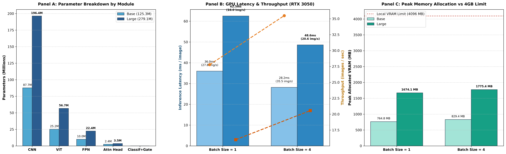

### 2. Trạng Thái Các Checkpoint Hiện Có Trong `Trainedmodel/`

| Tệp checkpoint | Dung lượng | Vai trò hiện tại | Chỉ số ghi trong checkpoint | Ghi chú ngưỡng |
|:---|---:|:---|:---|:---|
| `hybrid_large_v2.pth` | `4.16 GiB` (`4.47 GB`) | **Mặc định trên Web** (`Backend/ai_service/.env`) | Stage 2, Epoch `11`, Val `best_auroc = 0.8639` | Kèm optimizer/scheduler; chưa có `optimal_thresholds.npy` (dùng `0.5`) |
| `hybrid_model.pth` | `2.08 GiB` (`2.23 GB`) | Dự phòng trên Web / mặc định CLI (`predict_single.py`, `run_predict.py`) | Fine-tune `SOTA_v2` Phase 1, Epoch `13`, Val `best_auroc = 0.8657` | Không chứa `optimal_thresholds`; mặc định `0.5` |
| `yolov11m.pt` | `153.8 MiB` (`161.3 MB`) | Bộ định vị bbox trên Web & `run_predict.py` | Ultralytics `8.4.120`, Epoch `45` (14 lớp VinDr-CXR); `precision=0.2243`, `recall=0.2376`, `mAP50=0.1973`, `mAP50-95=0.0946` | Không có 4 lớp `Pneumonia, Edema, Emphysema, Hernia` |

### 3. Kết Quả Đánh Giá Chẩn Đoán & Thử Nghiệm Ngoại Bộ

#### 3.1. Phân Tích Chẩn Đoán Theo Từng Nhãn Bệnh (`Hybrid Large` — `Results/Comparison/`)

Bảng dưới tổng hợp kết quả benchmark 15 lớp từ [`Results/Comparison/large_per_class_diagnostics.csv`](Results/Comparison/large_per_class_diagnostics.csv) (trung bình cộng 15 lớp `Mean AUROC = 0.8693`):

| Nhãn bệnh | AUROC Test | Tỉ lệ dương tập Train (%) | Tổng GT BBox (VinDr) |
|:---|---:|---:|---:|
| `No Finding` | `0.8341` | `55.88%` | `0` |
| `Atelectasis` | `0.8407` | `9.28%` | `279` |
| `Cardiomegaly` | `0.9355` | `3.98%` | `5,427` |
| `Effusion` | `0.8965` | `11.34%` | `2,471` |
| `Infiltration` | `0.7429` | `16.24%` | `1,247` |
| `Mass` | `0.8758` | `4.71%` | `444` |
| `Nodule` | `0.8104` | `5.52%` | `2,136` |
| `Pneumonia` | `0.7995` | `1.12%` | `0` |
| `Pneumothorax` | `0.9037` | `4.23%` | `226` |
| `Consolidation` | `0.8384` | `3.95%` | `556` |
| `Edema` | `0.9041` | `1.83%` | `0` |
| `Emphysema` | `0.9354` | `2.01%` | `0` |
| `Fibrosis` | `0.8857` | `2.54%` | `4,655` |
| `Pleural_Thickening` | `0.8781` | `4.25%` | `4,838` |
| `Hernia` | `0.9583` | `0.18%` | `0` |

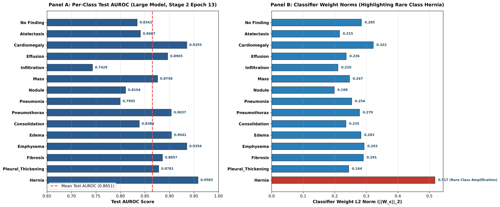

*(Ghi chú minh bạch: Trong biểu đồ [`Results/Comparison/large_auroc_vs_imbalance.png`](Results/Comparison/large_auroc_vs_imbalance.png), `compare_models.py` gắn cứng đường nét đứt `0.8651` và tiêu đề `Stage 2 Epoch 13`, trong khi trung bình 15 giá trị `Test_AUROC` của bảng `large_per_class_diagnostics.csv` là `0.8693`; Panel B cho thấy lớp hiếm `Hernia` (`0.18%` mẫu dương) có chuẩn L2 trọng số phân loại cao nhất ở mức `0.517`.)*

---

#### 3.2. So Sánh Hai Bộ Kiểm Thử: `NIH Thuần` (`22,433` ảnh) vs `Hybrid NIH+VinDr` (`12,427` ảnh)

Repository lưu giữ đầy đủ 2 bộ biểu đồ đánh giá hoàn chỉnh gồm **8 biểu đồ mỗi bộ** tại [`Results/NIH/`](Results/NIH/) và [`Results/Hybrid/`](Results/Hybrid/). Khi gộp thêm nguồn VinDr-CXR vào tập kiểm thử Hybrid, phân bố nhãn thay đổi mạnh: các bệnh lý có mật độ GT BBox cao trên VinDr (`Cardiomegaly`, `Fibrosis`, `Pleural_Thickening`) tăng mạnh **PR-AUC**, trong khi các nhãn ít gặp hoặc phân tán theo phân phối nguồn (`Pneumonia`, `Pneumothorax`, `Edema`) sụt giảm PR-AUC và làm AUROC trung bình giảm nhẹ từ `0.8895` xuống `0.8758`.

| Tiêu chí so sánh | Bộ kiểm thử `NIH Thuần` (`Results/NIH/`) | Bộ kiểm thử `Hybrid NIH + VinDr-CXR` (`Results/Hybrid/`) | Chênh lệch (`Hybrid − NIH`) |
|:---|---:|---:|---:|
| **Số ảnh Test (số cặp ảnh × 15 lớp)** | `22,433` (`336,495`) | `12,427` (`186,405`) | `-10,006` ảnh |
| **Mean AUROC (15 lớp)** | `0.8895` | `0.8758` | `-0.0137` |
| **Mean PR-AUC (15 lớp)** | `0.4451` | `0.4211` | `-0.0240` |
| **Ngưỡng tối ưu Macro-F1** | `0.65` | `0.65` | `0.00` |
| **Ma trận nhầm lẫn tổng (`TN / FP / FN / TP`)** | `238,202 / 69,823 / 2,007 / 26,463` | `134,882 / 35,753 / 1,458 / 14,312` | Tổng hợp `15` lớp |

<details>
<summary><strong>Xem bảng đối chiếu chi tiết AUROC &amp; PR-AUC cho toàn bộ 15 lớp giữa bộ NIH và bộ Hybrid</strong></summary>

| Nhãn bệnh | `NIH` AUROC | `Hybrid` AUROC | `NIH` PR-AUC | `Hybrid` PR-AUC | Nhận xét chênh lệch đáng chú ý |
|:---|---:|---:|---:|---:|:---|
| `No Finding` | `0.8348` | `0.8346` | `0.8460` | `0.8703` | PR-AUC tăng (`+0.0243`) nhờ tỷ lệ ảnh lành VinDr |
| `Atelectasis` | `0.8733` | `0.8567` | `0.4907` | `0.4298` | Giảm nhẹ khi hòa trộn hai miền dữ liệu |
| `Cardiomegaly` | `0.9446` | `0.9361` | `0.4365` | **`0.6475`** | **PR-AUC tăng mạnh `+0.2110`** nhờ `5,427` GT BBox VinDr |
| `Effusion` | `0.9125` | `0.9048` | `0.6325` | `0.5924` | Duy trì trên `0.90` AUROC ở cả hai bộ |
| `Infiltration` | `0.7479` | `0.7425` | `0.4127` | `0.3652` | Nhãn mơ hồ nhất trên cả hai bộ kiểm thử |
| `Mass` | `0.9187` | `0.8980` | `0.5311` | `0.4255` | AUROC duy trì mức ~`0.90` |
| `Nodule` | `0.8708` | `0.8533` | `0.4067` | `0.3606` | Tổn thương kích thước nhỏ phụ thuộc độ phân giải |
| `Pneumonia` | `0.8249` | `0.7893` | `0.1176` | `0.0409` | Dương tính rất hiếm (`1.12%` Train), độ nhạy thấp |
| `Pneumothorax` | `0.9360` | `0.8965` | `0.5829` | `0.3750` | PR-AUC giảm khi gộp miền ảnh VinDr |
| `Consolidation` | `0.8574` | `0.8537` | `0.2513` | `0.2399` | Gần như ổn định giữa hai bộ kiểm thử |
| `Edema` | `0.9284` | `0.9110` | `0.2570` | `0.1731` | Không có GT BBox trên VinDr (`0` box) |
| `Emphysema` | `0.9628` | `0.9521` | `0.5388` | `0.3930` | AUROC cao trên `0.95` ở cả hai bộ |
| `Fibrosis` | `0.8879` | `0.8838` | `0.2462` | **`0.5037`** | **PR-AUC tăng hơn gấp đôi (`+0.2575`)** với `4,655` GT BBox |
| `Pleural_Thickening` | `0.8546` | `0.8705` | `0.2607` | **`0.4361`** | **Cả AUROC & PR-AUC đều tăng** với `4,838` GT BBox |
| `Hernia` | `0.9877` | `0.9546` | `0.6661` | `0.4635` | Cực hiếm (`0.18%` Train), AUROC > `0.95` trên cả hai bộ |

</details>

<table>
  <thead>
    <tr>
      <th width="50%">Bộ kiểm thử NIH Thuần (<code>22,433</code> ảnh — <code>Results/NIH/</code>)</th>
      <th width="50%">Bộ kiểm thử Hybrid NIH + VinDr-CXR (<code>12,427</code> ảnh — <code>Results/Hybrid/</code>)</th>
    </tr>
  </thead>
  <tbody>
    <tr>
      <td align="center">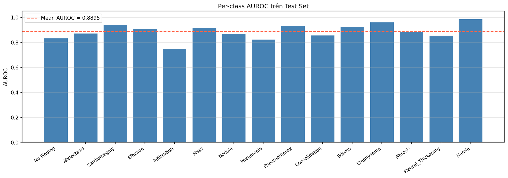<br/><sub><b>AUROC từng lớp</b> — Mean AUROC = <code>0.8895</code></sub></td>
      <td align="center">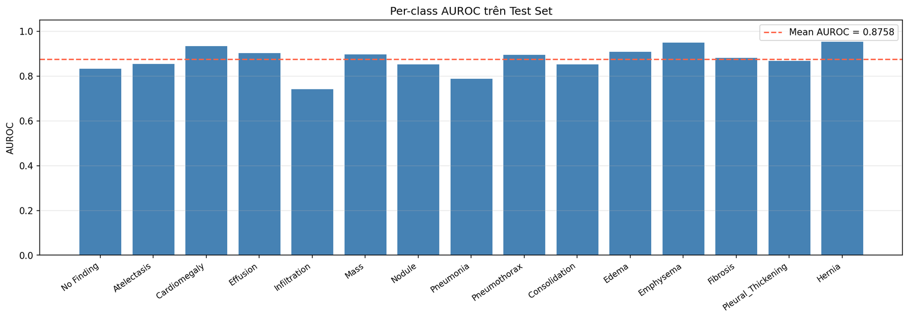<br/><sub><b>AUROC từng lớp</b> — Mean AUROC = <code>0.8758</code></sub></td>
    </tr>
    <tr>
      <td align="center">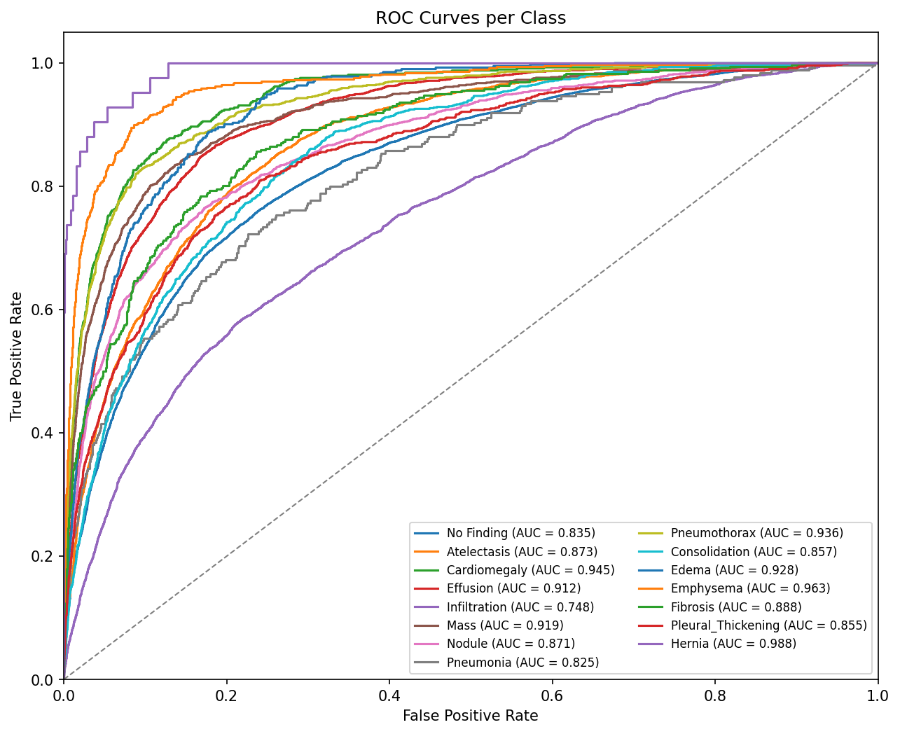<br/><sub><b>Đường cong ROC (15 lớp)</b> — AUC <code>0.748</code> .. <code>0.988</code></sub></td>
      <td align="center">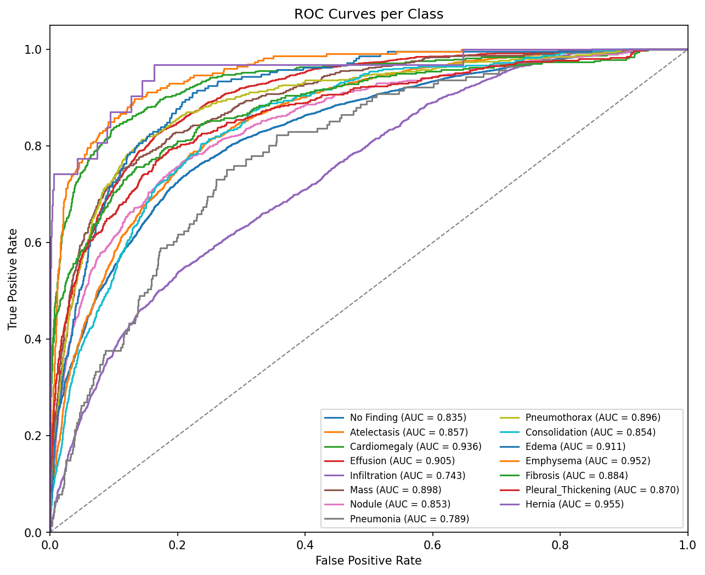<br/><sub><b>Đường cong ROC (15 lớp)</b> — AUC <code>0.743</code> .. <code>0.955</code></sub></td>
    </tr>
    <tr>
      <td align="center">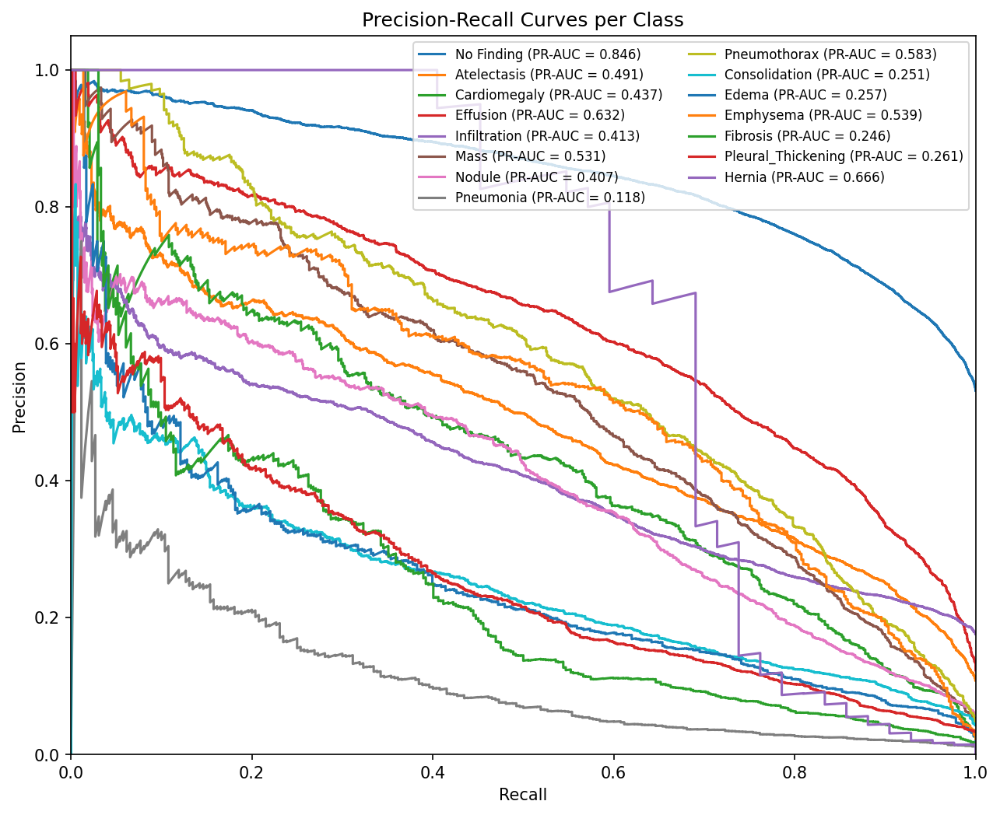<br/><sub><b>Đường cong Precision–Recall</b> — Mean PR-AUC = <code>0.4451</code></sub></td>
      <td align="center">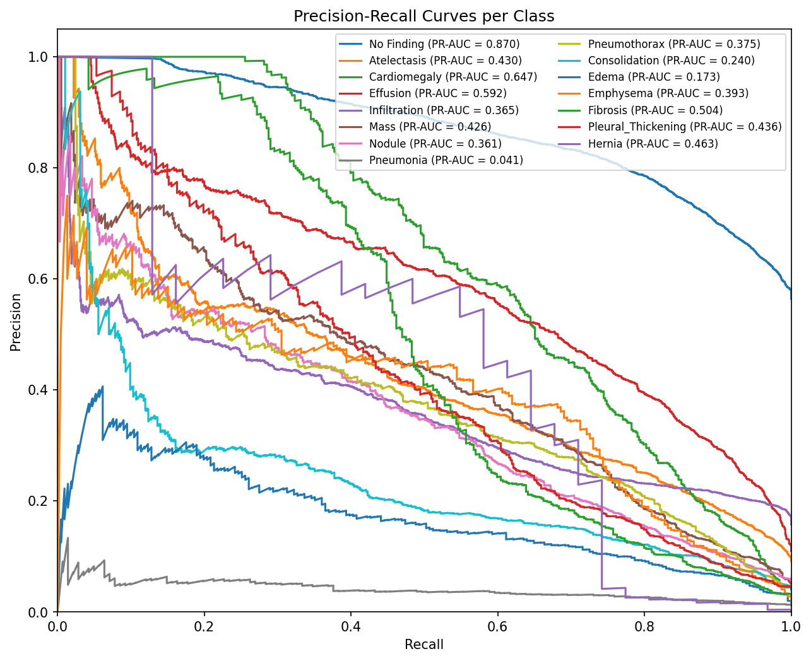<br/><sub><b>Đường cong Precision–Recall</b> — Mean PR-AUC = <code>0.4211</code></sub></td>
    </tr>
    <tr>
      <td align="center">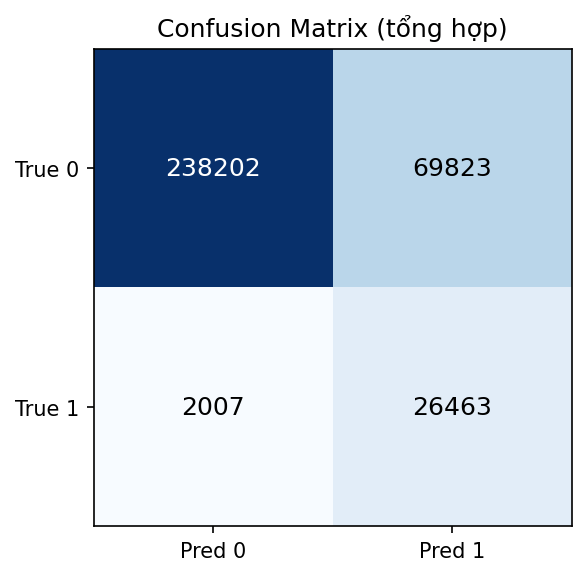<br/><sub><b>Confusion Matrix tổng hợp</b> (<code>336,495</code> lượt đánh giá)</sub></td>
      <td align="center">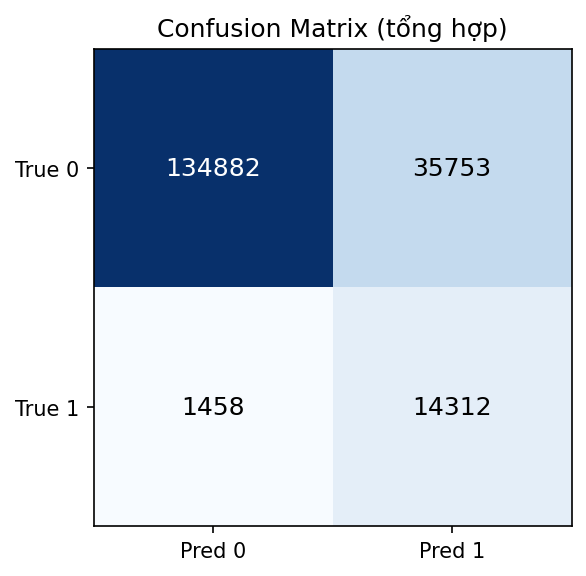<br/><sub><b>Confusion Matrix tổng hợp</b> (<code>186,405</code> lượt đánh giá)</sub></td>
    </tr>
  </tbody>
</table>

<details>
<summary><strong>Xem thêm 4 cặp biểu đồ chẩn đoán chi tiết (Confusion Matrix 15 lớp, Macro-F1 theo ngưỡng, Phân phối xác suất, Bảng console)</strong></summary>

<table>
  <thead>
    <tr>
      <th width="50%">Bộ kiểm thử NIH Thuần (<code>Results/NIH/</code>)</th>
      <th width="50%">Bộ kiểm thử Hybrid NIH + VinDr-CXR (<code>Results/Hybrid/</code>)</th>
    </tr>
  </thead>
  <tbody>
    <tr>
      <td align="center">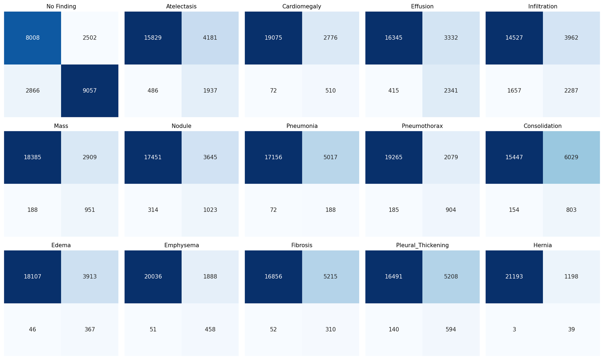<br/><sub><b>Ma trận nhầm lẫn 15 lớp</b> (NIH)</sub></td>
      <td align="center">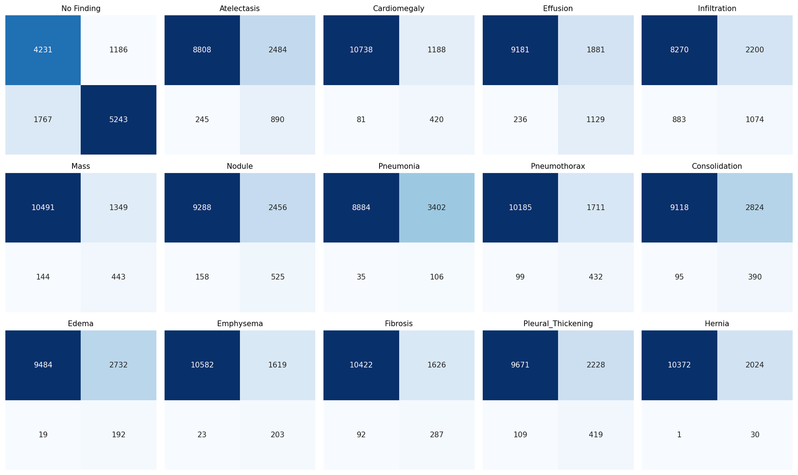<br/><sub><b>Ma trận nhầm lẫn 15 lớp</b> (Hybrid)</sub></td>
    </tr>
    <tr>
      <td align="center">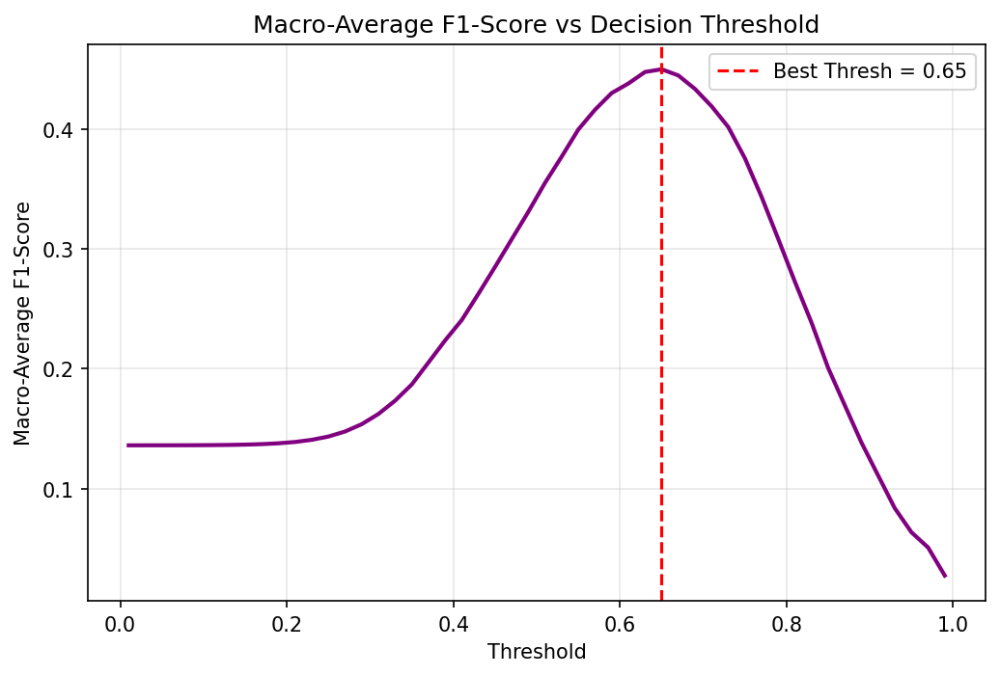<br/><sub><b>Macro-F1 theo ngưỡng</b> — Best Thresh = <code>0.65</code> (đỉnh ~<code>0.45</code>)</sub></td>
      <td align="center">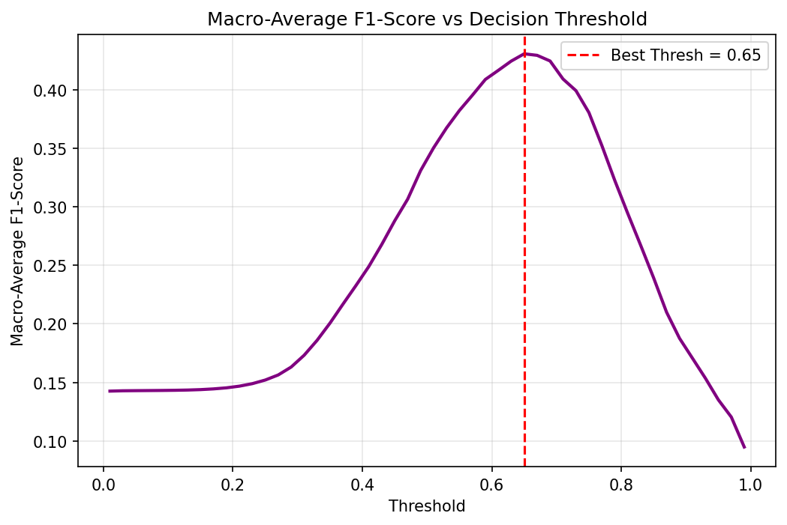<br/><sub><b>Macro-F1 theo ngưỡng</b> — Best Thresh = <code>0.65</code> (đỉnh ~<code>0.43</code>)</sub></td>
    </tr>
    <tr>
      <td align="center">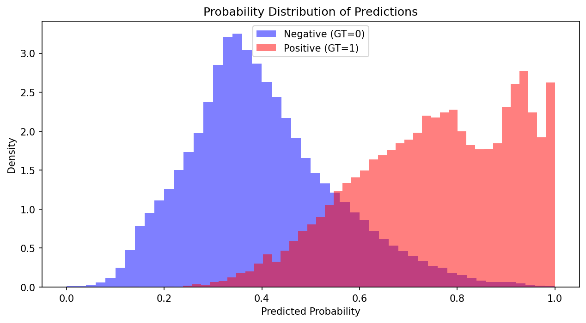<br/><sub><b>Phân phối xác suất dự đoán</b> (<code>GT=0</code> vs <code>GT=1</code>)</sub></td>
      <td align="center">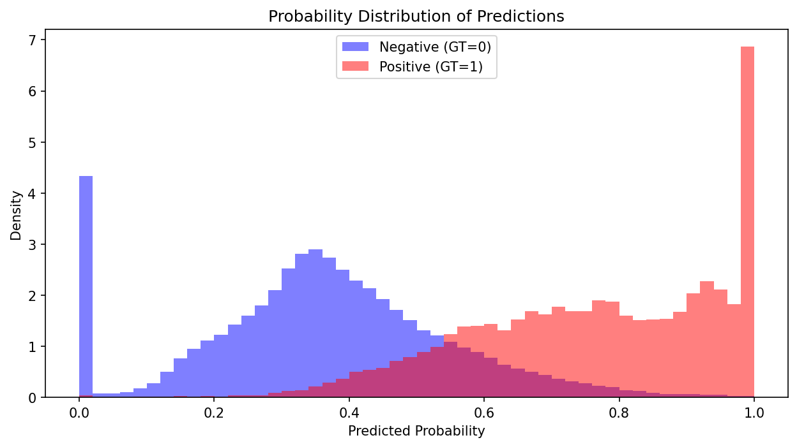<br/><sub><b>Phân phối xác suất dự đoán</b> (<code>GT=0</code> vs <code>GT=1</code>)</sub></td>
    </tr>
    <tr>
      <td align="center">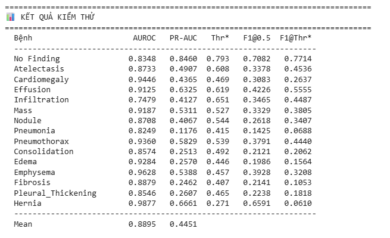<br/><sub><b>Bảng log số liệu console</b> (NIH — Mean <code>0.8895</code> / <code>0.4451</code>)</sub></td>
      <td align="center">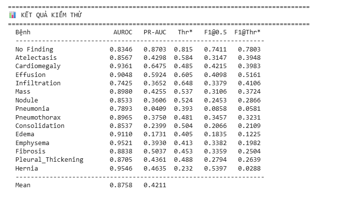<br/><sub><b>Bảng log số liệu console</b> (Hybrid — Mean <code>0.8758</code> / <code>0.4211</code>)</sub></td>
    </tr>
  </tbody>
</table>

</details>

---

#### 3.3. Thử Nghiệm Ngoại Bộ Trên 200 Ảnh X-Quang Nhi Khoa Kermany (`100 NORMAL` / `100 PNEUMONIA`)

Kiểm thử ngoài phân phối (OOD) thực hiện qua [`Backend/tools/summarize_public_evaluation.py`](Backend/tools/summarize_public_evaluation.py) trên bộ dữ liệu nhi khoa `probml/chest_xray_kaggle` (ngưỡng mặc định `0.5`, tài liệu chi tiết tại [`docs/danh-gia-200-anh-2026-11-08.md`](docs/danh-gia-200-anh-2026-11-08.md) và [`docs/kiem-thu-lai-yolo-2026-11-09.md`](docs/kiem-thu-lai-yolo-2026-11-09.md)):

| Cấu hình thử nghiệm | Độ chính xác | Sensitivity (`Pneumonia`) | Specificity (`Normal`) | F1-Score | AUROC | Ghi chú kỹ thuật |
|:---|---:|---:|---:|---:|---:|:---|
| **Chỉ nhãn gốc `Pneumonia` (API ≥ `0.5`) — trước & sau khi nối YOLO** | `52.00%` (`104/200`, CI95 `45.10%–58.82%`) | `4.00%` (`4/100`) | `100.00%` (`100/100`) | `0.0769` | `0.8819` | Bật YOLO đạt `200/200` lượt thành công, trả `76` khung trên `50/200` ảnh (chỉ quan sát định tính vì bộ ảnh không có GT BBox và `yolov11m.pt` không có lớp `Pneumonia`) |
| **Lỗi UI Top-6 cũ (chỉ hiển thị tối đa 6 nhãn đầu bảng)** | `51.00%` (`102/200`) | `2.00%` (`2/100`) | `100.00%` | — | — | Bỏ sót `2/4` ca dương (`TP=2, FN=98`) khi `Pneumonia` rơi khỏi Top-6 |
| **Quy tắc phụ: Bất kỳ bệnh lý gốc ≥ ngưỡng (`Any Pathology`)** | `87.50%` (`175/200`) | `90.00%` (`90/100`) | `85.00%` (`85/100`) | — | — | Cho thấy bộ đặc trưng nhận ra bất thường phổi nhưng bị lệch nhãn/ngưỡng sang nhóm khác (`Infiltration`, `Consolidation`, `Effusion`) trên X-quang trẻ em |

- **Ma trận nhầm lẫn chuẩn cho nhãn đích `Pneumonia` (ngưỡng `0.5`, `N = 200`)**: `TN = 100`, `FP = 0`, `FN = 96`, `TP = 4`. Kết quả minh họa rõ tác động của **lệch phân phối người lớn → trẻ em (domain shift)** và **ngưỡng bảo thủ `0.5`** đối với lớp hiếm (`1.12%` dương trong Train): khả năng phân hạng vẫn giữ tốt (`AUROC = 0.8819`) nhưng điểm xác suất tuyệt đối của `Pneumonia` hiếm khi vượt `0.5`.
- Ngoài tập Kermany, nhật ký thử nghiệm công khai trực tuyến (ảnh Wikimedia PA/AP) và phân tích đối chiếu lỗi nhãn được lưu chi tiết tại [`docs/ket-qua-test-online-2026-11-08.md`](docs/ket-qua-test-online-2026-11-08.md) và [`docs/doi-chieu-nhan-va-ket-qua-2026-11-09.md`](docs/doi-chieu-nhan-va-ket-qua-2026-11-09.md).

---

#### 3.4. Ảnh Mẫu Đầu Vào & Minh Họa Kết Quả Trực Quan (`Results/EX/`)

Chuỗi 4 ảnh mẫu dưới đây xuất từ ca bệnh **`Cardiomegaly` kèm tràn dịch màng phổi (`Effusion`)** trên ảnh X-quang thực tế [`Results/EX/Cardiomegally.png`](Results/EX/Cardiomegally.png) (`1060 × 960 px`, `828,344 bytes`, có máy tạo nhịp tim vùng ngực trái):

<table>
  <tbody>
    <tr>
      <td align="center" width="50%">
        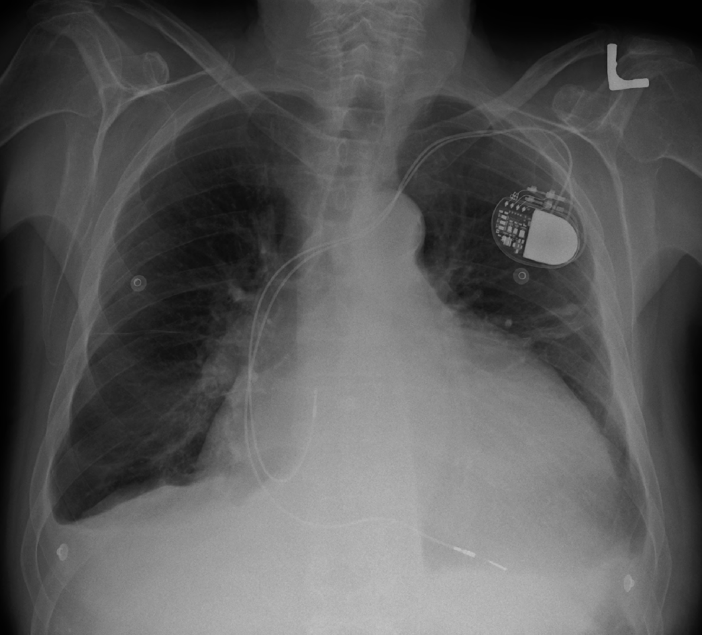<br/>
        <b>1. Ảnh X-quang đầu vào gốc</b> (<code>1060 × 960 px</code>)<br/>
        <sub>Bóng tim giãn rộng kèm máy tạo nhịp tim ở ngực trái.</sub>
      </td>
      <td align="center" width="50%">
        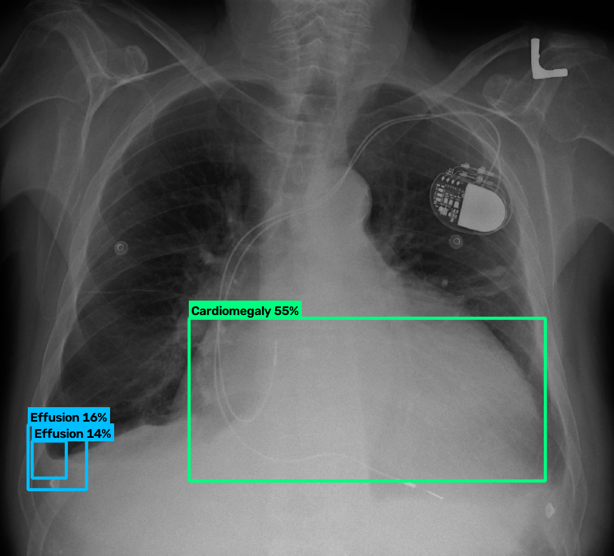<br/>
        <b>2. Định vị BBox chế độ CLI (<code>run_predict.py</code>)</b><br/>
        <sub>Khoanh vùng <code>Cardiomegaly 55%</code> (xanh lá) và 2 khung <code>Effusion 16% / 14%</code> (xanh lơ).</sub>
      </td>
    </tr>
    <tr>
      <td align="center" width="50%">
        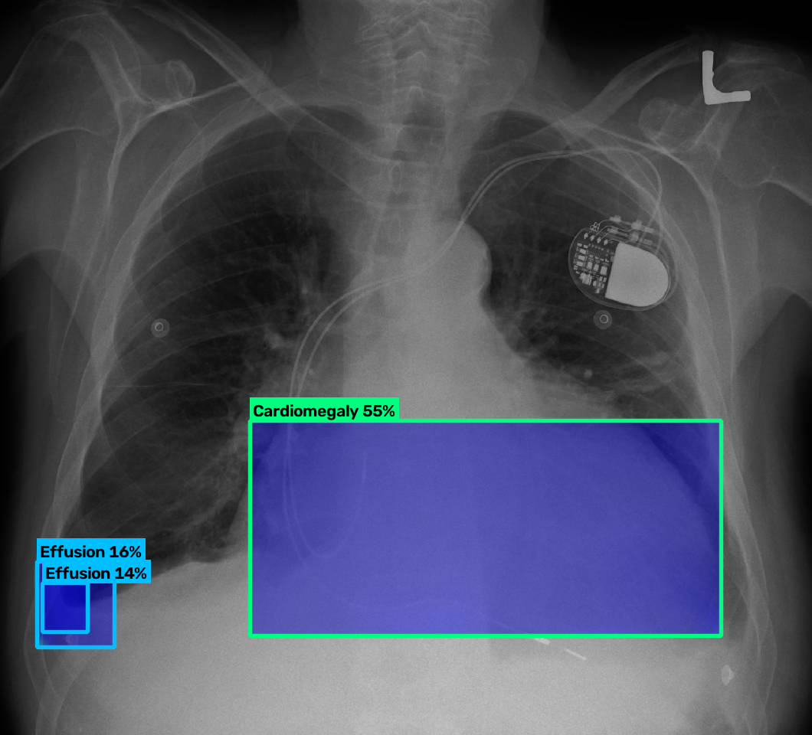<br/>
        <b>3. Bản đồ nhiệt Display Fusion</b><br/>
        <sub>Bản đồ chú ý của Classifier được hội tụ bên trong khung định vị BBox.</sub>
      </td>
      <td align="center" width="50%">
        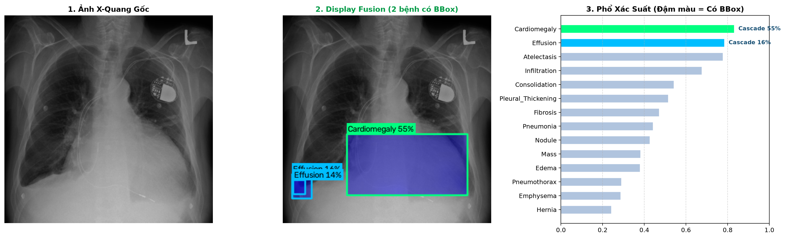<br/>
        <b>4. Tổng hợp 3 khung &amp; phổ xác suất 15 bệnh</b><br/>
        <sub>Đối chiếu trực tiếp ảnh gốc, Display Fusion và xác suất 15 nhãn (đậm màu = có BBox).</sub>
      </td>
    </tr>
  </tbody>
</table>

- **So sánh hành vi CLI (`hybrid_model.pth`) vs Web API `/v3/predict` (`hybrid_large_v2.pth` + `yolov11m.pt`) trên ca mẫu này**:
  - 3 ảnh tĩnh `_bbox.png`, `_fusion.png`, `_predict.png` ở trên là đầu ra kết xuất từ lệnh CLI `run_predict.py` với `hybrid_model.pth`.
  - Khi đưa qua API `/v3/predict` nối `yolov11m.pt`: bản ghi [`docs/noi-yolo-2026-11-09.md`](docs/noi-yolo-2026-11-09.md) với `hybrid_model.pth` ghi nhận **`6` khung Cascade** (`Cardiomegaly [326, 550, 941, 831]` YOLO `65.54%` / Cascade `54.51%`, kèm `Aortic enlargement`, `Calcification`, 3× `Pleural effusion`).
  - Với checkpoint mặc định hiện hành trên web (`hybrid_large_v2.pth`), `/v3/predict` trả **`7` khung YOLO** (gồm 2× `Cardiomegaly` với khung chính `[326, 549, 941, 830]` YOLO `65.57%` / Cascade `63.28%`, `Aortic enlargement`, `Calcification`, 3× `Pleural effusion`) và bổ sung **`10` `hybrid_boxes`** (`2` khung/bệnh cho `Atelectasis`, `Infiltration`, `Consolidation`, `Pleural_Thickening`, `Pneumonia`).

---

## 🚀 Hướng Dẫn Cài Đặt, Khởi Chạy & Kiểm Thử

### Bước 1: Chuẩn Bị Môi Trường

Yêu cầu **Python 3.10+**, **Node.js 20+**, **Docker Desktop / MongoDB 7** (và tùy chọn GPU NVIDIA + CUDA).

```powershell
# 1. Tạo virtual environment Python (.venv ở thư mục gốc)
python -m venv .venv
.\.venv\Scripts\Activate.ps1

# 2. Cài đầy đủ thư viện cho AI Core, AI Service và kiểm thử PDF
pip install -r requirements.txt
pip install -r Backend/requirements.txt
pip install -r Backend/ai_service/requirements.txt
pip install -r Backend/tests/requirements.txt

# 3. Cài phụ thuộc và build Backend Gateway (Express TypeScript)
cd Backend
yarn install
yarn build
cd ..

# 4. Cài phụ thuộc Frontend (React 19 + Vite 8)
cd Frontend
yarn install
cd ..
```

Đặt sẵn file trọng số trong `Trainedmodel/`: `hybrid_large_v2.pth` (hoặc `hybrid_model.pth`) và `yolov11m.pt`. Kiểm tra cấu hình mẫu tại `Backend/.env.example`, `Backend/ai_service/.env.example`, và `Frontend/.env.example`.

### Bước 2: Khởi Động Hạ Tầng & Hệ Thống Web (3 Dịch Vụ)

```powershell
# Khởi động MongoDB & Redis qua Docker Compose
docker compose -f Backend/docker-compose.yml up -d mongodb redis

# Khởi chạy đồng thời AI Service (:8000), API Gateway (:3006) và Frontend (:5173)
.\start-web.ps1
```

Các địa chỉ mặc định sau khi khởi chạy:
- **Giao diện chính**: `http://127.0.0.1:5173/`
- **Công cụ nghiên cứu cũ (legacy)**: `http://127.0.0.1:5173/legacy.html`
- **Swagger API Gateway**: `http://127.0.0.1:3006/docs`
- **AI Service Health**: `http://127.0.0.1:8000/health`

Tài khoản seed mặc định trong `Backend/src/common/migration/seedData.ts`:
- Admin: `admin@chexnet.vn` / `Admin@123456`
- Bác sĩ: `bacsi@chexnet.vn` / `Doctor@123456`

*(Lưu ý: Nếu chỉ chạy riêng AI FastAPI thủ công để phục vụ đầy đủ `/v3/predict`, CLIP validator, DICOM và `ReferenceStore`, cần gọi `uvicorn Backend.ai_service.main:app --host 127.0.0.1 --port 8000` thay vì gọi trực tiếp `Backend.main:app`.)*

### Bước 3: Chạy CLI Độc Lập (Không Cần Web Stack)

```powershell
# Suy luận hàng loạt trong Results/EX/ kèm YOLO11m & Attention ROI
python run_predict.py

# Hoặc suy luận 1 ảnh cụ thể
python run_predict.py duong_dan_anh.png

# Suy luận tương tác 15 nhãn (mặc định Trainedmodel/hybrid_model.pth)
python predict_single.py

# Huấn luyện / kiểm thử (yêu cầu dữ liệu ảnh trong Database/)
python main.py --mode test --model-size large --tta-views 4
```

### Bước 4: Chạy Bộ Kiểm Thử (Unit Test & Integration)

```powershell
# Unit test Python (8 suite trong Backend/tests)
.\.venv\Scripts\python.exe -m unittest discover -s Backend\tests -v

# Unit test Node (box validation + nhất quán upload/DB; cần Backend đã build & MongoDB)
node --test Frontend\tests\yoloBoxes.test.cjs Backend\tests\upload-consistency.test.cjs

# E2E API thật qua Gateway -> MongoDB -> AI Service (cần AI Service đang chạy tại :8000)
node --test Backend\tests\upload-api.test.cjs

# Build kiểm tra TypeScript Frontend
cd Frontend; yarn build
```

---

## 📚 Danh Mục Bệnh Lý Nhận Diện

Mô hình phân loại **14 nhãn bệnh lý/dấu hiệu và 1 nhãn `No Finding`**. Bảng dưới đây giữ đúng thứ tự kênh đầu ra (`0..14`) của mã huấn luyện, AI Service và Frontend; tên tiếng Việt được dùng thống nhất trên giao diện web và PDF báo cáo.

| STT | Tên tiếng Anh | Tên tiếng Việt | Mức độ lâm sàng |
|:---:|:---|:---|:---:|
| 0 | **No Finding** | Không phát hiện bất thường | Bình thường |
| 1 | **Atelectasis** | Xẹp phổi | Trung bình |
| 2 | **Cardiomegaly** | Phì đại bóng tim (Tim to) | Nguy cơ cao |
| 3 | **Effusion** | Tràn dịch màng phổi | Nguy cơ cao |
| 4 | **Infiltration** | Thâm nhiễm nhu mô phổi | Trung bình |
| 5 | **Mass** | Khối u phổi (> 3cm) | Cần sinh thiết |
| 6 | **Nodule** | Nốt mờ phổi (≤ 3cm) | Cần theo dõi |
| 7 | **Pneumonia** | Viêm phổi | Khẩn cấp |
| 8 | **Pneumothorax** | Tràn khí màng phổi | Cấp cứu tối khẩn |
| 9 | **Consolidation** | Đông đặc phế nang | Nguy cơ cao |
| 10 | **Edema** | Phù phổi cấp | Nguy cơ cao |
| 11 | **Emphysema** | Khí phế thũng | Bệnh mạn tính |
| 12 | **Fibrosis** | Xơ hóa phổi | Bệnh mạn tính |
| 13 | **Pleural Thickening** | Dày màng phổi | Theo dõi |
| 14 | **Hernia** | Thoát vị hoành | Hiếm gặp |

> **Lưu ý về khóa kỹ thuật và mô tả nhãn:**
> - Nhãn hiển thị `"Pleural Thickening"` ánh xạ trực tiếp khóa kỹ thuật `Pleural_Thickening` trong mô hình và JSON API.
> - Phần mô tả kích thước trong `"Khối u phổi (> 3cm)"` và `"Nốt mờ phổi (≤ 3cm)"` là định nghĩa phân loại chuẩn của bộ nhãn Mass/Nodule, **không** phải kết quả đo đạc kích thước tổn thương từ ảnh chụp.

---

## ⚖️ Tuyên Bố Miễn Trừ Trách Nhiệm Y Tế

*CheXNet Hybrid AI là hệ thống nghiên cứu học thuật hỗ trợ ra quyết định lâm sàng (CADx). Toàn bộ xác suất phân loại, bản đồ chú ý, khung định vị YOLO/Hybrid và báo cáo sinh tự động chỉ có giá trị tham khảo cho bác sĩ chuyên khoa; hệ thống không thay thế chẩn đoán xác định và chỉ định điều trị y khoa chính thức.*
