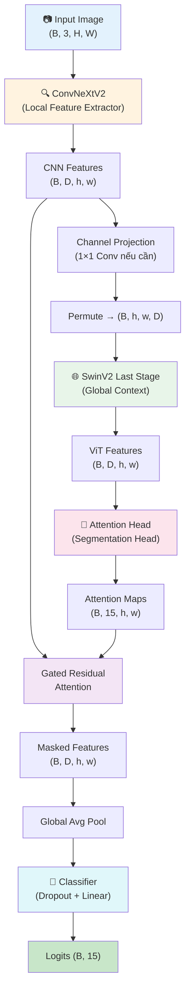
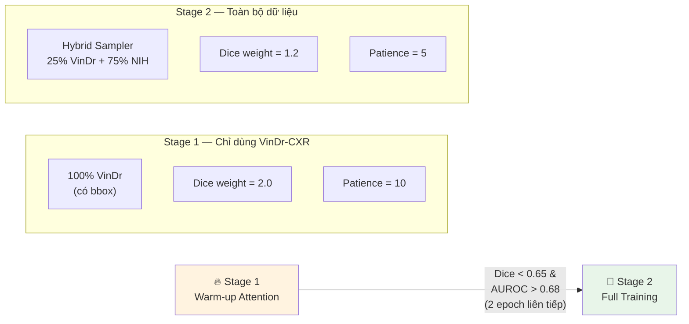
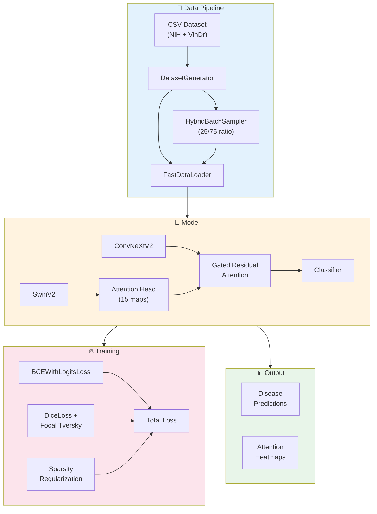

# 🔬 Phân Tích Dự Án: Hybrid CNN-ViT Multi-Label Chest X-ray Classification

## 1. Tổng Quan

Dự án xây dựng hệ thống **phân loại đa nhãn (multi-label) ảnh X-quang ngực** sử dụng kiến trúc lai (hybrid) kết hợp **ConvNeXtV2** (CNN) và **SwinV2** (Vision Transformer) với cơ chế **Residual Masking** để vừa phân loại bệnh, vừa định vị vùng tổn thương (attention map) hỗ trợ bác sĩ chẩn đoán.

### Bộ dữ liệu
- **NIH ChestX-ray14**: ~112K ảnh, chỉ có nhãn bệnh (không có bounding box)
- **VinDr-CXR**: ~18K ảnh, có cả nhãn bệnh VÀ bounding box annotation

### 15 nhãn bệnh phân loại
`No Finding`, `Atelectasis`, `Cardiomegaly`, `Effusion`, `Infiltration`, `Mass`, `Nodule`, `Pneumonia`, `Pneumothorax`, `Consolidation`, `Edema`, `Emphysema`, `Fibrosis`, `Pleural_Thickening`, `Hernia`

---

## 2. Kiến Trúc Mô Hình

> File: [Model.py](file:///d:/temp/Model.py)



### Các thành phần chính

| Thành phần | Mô tả | Cấu hình Base | Cấu hình Large |
|---|---|---|---|
| **CNN Backbone** | ConvNeXtV2 (pretrained IN22K→IN1K) | `convnextv2_base` (1024-dim) | `convnextv2_large` (1536-dim) |
| **ViT Backbone** | SwinV2 last stage only (pretrained) | `swinv2_base` (1024-dim) | `swinv2_large` (1536-dim) |
| **Attention Head** | Conv3×3 → BN → GELU → Conv1×1 → Sigmoid | Output: 15 channels (1/bệnh) | Output: 15 channels |
| **Classifier** | Dropout(0.3) → Linear | 1024 → 15 | 1536 → 15 |

### Cơ chế Gated Residual Attention (điểm nhấn thiết kế)

```
masked_features = cnn_features + gate_alpha × (cnn_features × attention_map)
```

Đây là thiết kế **per-class channel grouping**:
- 1024 kênh CNN được chia thành **15 nhóm** (mỗi bệnh 1 nhóm ~68 kênh)
- Mỗi nhóm kênh chỉ bị gate bởi **đúng** attention map của bệnh tương ứng
- `gate_alpha` là tham số học được, bị giới hạn trong `[0, 0.8]` qua Sigmoid

> [!IMPORTANT]
> **Thiết kế đáng chú ý**: Mỗi bệnh có attention map riêng thay vì 1 map dùng chung — cho phép mô hình học khoanh vùng tổn thương đặc trưng cho từng bệnh (tim to vs. khối u vs. tràn dịch...).

---

## 3. Pipeline Huấn Luyện 2 Giai Đoạn

> File: [TrainModel.py](file:///d:/temp/TrainModel.py)



### Loss Functions

| Loss | Mô tả | Áp dụng cho |
|---|---|---|
| **BCEWithLogitsLoss** | Phân loại nhãn bệnh | Toàn bộ batch |
| **DiceLoss + Focal Tversky** | Đo chất lượng attention map vs. GT bbox | Chỉ ảnh VinDr có bbox hợp lệ |
| **AttentionSparsityLoss** | Regularization: giữ density ~15%, entropy thấp | Toàn bộ batch |

#### DiceLoss chi tiết ([L18-L88](file:///d:/temp/TrainModel.py#L18-L88))

- **Multi-channel**: Tính Dice/Tversky riêng cho từng kênh bệnh
- **Valid mask**: Chỉ tính trên kênh THỰC SỰ có ground-truth bbox (bỏ qua kênh không annotation)
- **Label smoothing**: GT mask 0/1 → `eps`/`1-eps` để tránh gradient vanishing
- **Focal Tversky** (`α=0.3, β=0.7`): Phạt False Negative nặng hơn (ưu tiên không bỏ sót)
- **Focal gamma** (`0.75`): Kéo dãn gradient ở vùng loss cao

#### AttentionSparsityLoss ([L91-L127](file:///d:/temp/TrainModel.py#L91-L127))

- **L1 density HAI PHÍA**: Phạt khi mean attention lệch khỏi target (0.15) theo cả 2 hướng
- **Binary entropy**: Ép attention về 0 hoặc 1 (viền rõ ràng)

### Learning Rate Schedule

```
Epoch 1-3:  LinearLR warmup (1e-5 → 1e-4)
Epoch 4+:   CosineAnnealing (→ 1e-6)
```

Optimizer: **AdamW** (`lr=1e-4`, `weight_decay=0.05`)

---

## 4. Data Pipeline

> File: [read_data.py](file:///d:/temp/read_data.py)

### Đọc dữ liệu CSV ([L68-L143](file:///d:/temp/read_data.py#L68-L143))

- **Gộp nhóm** theo `Image Index` (xử lý nhiều radiologist annotate cùng 1 ảnh)
- **Nhãn**: OR giữa các radiologist
- **Bbox**: Gom theo từng bệnh riêng biệt (15 kênh mask độc lập)

### Preload RAM ([L145-L197](file:///d:/temp/read_data.py#L145-L197))

- Lưu **bytes thô** (chưa decode) để tiết kiệm RAM (~10-20x nhỏ hơn ảnh decode)
- Tận dụng **copy-on-write** trên Linux khi fork worker processes

### Data Augmentation

| Train | Validation |
|---|---|
| RandomResizedCrop(scale=0.75-1.0) | Resize(img_size × 1.14) |
| RandomHorizontalFlip(0.5) | CenterCrop(img_size) |
| RandomRotation(15°) | |
| RandomAffine(translate=0.1) | |

> [!TIP]
> Transform được áp dụng đồng bộ cho cả ảnh và mask bằng cách **ghép tensor** (3 kênh ảnh + 15 kênh mask) rồi transform cùng lúc ([L253-L263](file:///d:/temp/read_data.py#L253-L263)).

### HybridBatchSampler ([L315-L351](file:///d:/temp/read_data.py#L315-L351))

Cho Stage 2: Mỗi batch luôn có **25% VinDr + 75% NIH/khác**, đảm bảo Dice loss luôn có ảnh có bbox để học.

---

## 5. Visualization & Testing

### Attention Map Visualization
> File: [head_map.py](file:///d:/temp/head_map.py)

- Trích xuất 15 attention map từ mô hình đã train
- Hiển thị heatmap overlay cho các bệnh dương tính (prob ≥ threshold)
- Sắp xếp theo xác suất giảm dần, giới hạn tối đa 6 bệnh hiển thị

### Testing Pipeline
> File: [main.py](file:///d:/temp/main.py#L158-L299)

- Per-class AUROC + Mean AUROC
- Classification Report (precision/recall/F1)
- Confusion Matrix (tổng hợp)
- Lưu biểu đồ AUROC bar chart

---

## 6. Sơ Đồ Kiến Trúc Tổng Thể



---

## 7. Đánh Giá Kỹ Thuật

### ✅ Điểm Mạnh

| # | Điểm mạnh | Chi tiết |
|---|---|---|
| 1 | **Kiến trúc hybrid thông minh** | CNN (local features) + ViT (global context) bổ trợ lẫn nhau |
| 2 | **Per-class attention** | 15 attention map riêng cho 15 bệnh — giải thích được (explainable AI) |
| 3 | **Training 2 giai đoạn** | Warm-up attention trên VinDr (có bbox) trước khi train toàn bộ |
| 4 | **Loss design cẩn thận** | Dice + Focal Tversky (ưu tiên recall) + Sparsity (chống collapse) |
| 5 | **Valid mask multi-channel** | Chỉ tính Dice trên kênh thực sự có annotation — tránh penalty sai |
| 6 | **Gate alpha học được + bounded** | Giới hạn [0, 0.8] tránh attention "ăn gian" |
| 7 | **Preload bytes thô** | Tiết kiệm RAM 10-20x so với decode sẵn PIL |
| 8 | **Sync transform ảnh+mask** | Ghép tensor rồi transform cùng lúc — đúng về mặt không gian |
| 9 | **Comment/docstring cực kỹ** | Giải thích lý do thiết kế rất chi tiết (tại sao, không chỉ cái gì) |
| 10 | **Resume checkpoint đầy đủ** | Lưu/phục hồi epoch, stage, best_auroc, model_size, img_size |

### ⚠️ Điểm Cần Cải Thiện

| # | Vấn đề | Mức độ | Giải pháp đề xuất |
|---|---|---|---|
| 1 | **Không có Mixed Precision (AMP)** | 🟡 Hiệu năng | Thêm `torch.cuda.amp.GradScaler` + `autocast` để tiết kiệm VRAM và tăng tốc 30-50% |
| 2 | **`computeAUROC_mean` dùng bare `except`** | 🟡 Code quality | Đổi thành `except ValueError` tại [L487](file:///d:/temp/TrainModel.py#L487) |
| 3 | **Không log per-class AUROC khi train** | 🟡 Monitoring | Thêm logging TensorBoard/WandB để theo dõi từng bệnh qua các epoch |
| 4 | **`HybridBatchSampler` có thể bị wrap-around lỗi** | 🟡 Bug tiềm ẩn | Khi `v_start + vin_per_batch > len(vin_idx)`, slice sẽ thiếu sample — cần xử lý circular indexing |
| 5 | **Không có Test-Time Augmentation (TTA)** | 🟢 Enhancement | Thêm TTA (flip, multi-crop) cho inference để tăng AUROC |
| 6 | **Validation chỉ dùng BCE loss** | 🟢 Enhancement | Có thể thêm Dice loss vào val để so sánh với train |
| 7 | **Không normalize attention map trước khi tính Dice** | 🟢 Design | Attention đã qua Sigmoid ([0,1]) nên OK, nhưng có thể thêm min-max normalize per-sample |
| 8 | **`accuracy_score` trên multi-label** | 🟡 Metrics | Flatten toàn bộ rồi tính accuracy không phản ánh đúng — nên dùng `subset accuracy` hoặc `hamming loss` |
| 9 | **Không có class-balanced BCE** | 🟢 Enhancement | Có hàm `get_class_weights()` nhưng không được sử dụng trong training |

### 🔍 Vấn đề Tiềm Ẩn Cần Lưu Ý

> [!WARNING]
> **Sync Transform với ColorJitter**: Hiện tại data augmentation chỉ dùng geometric transforms (crop, flip, rotate, affine). Nếu sau này thêm ColorJitter hoặc các photometric transforms, cần đảm bảo chúng **KHÔNG** áp dụng lên mask channels (chỉ áp dụng cho 3 kênh RGB đầu tiên).

> [!CAUTION]
> **Duplicate comment tại [Model.py:14-15](file:///d:/temp/Model.py#L14-L15)**: Dòng comment `# Chọn cấu hình cặp Backbone` bị lặp 2 lần.

---

## 8. Cấu Trúc File

| File | Dòng | Chức năng |
|---|---|---|
| [Model.py](file:///d:/temp/Model.py) | 132 | Kiến trúc `HybridCNNViTModel` |
| [TrainModel.py](file:///d:/temp/TrainModel.py) | 490 | Loss functions + `HybridTrainer` (train/val/AUROC) |
| [read_data.py](file:///d:/temp/read_data.py) | 352 | `DatasetGenerator`, `FastDataLoader`, `HybridBatchSampler` |
| [main.py](file:///d:/temp/main.py) | 312 | CLI entry point (Train/Resume/Test) |
| [head_map.py](file:///d:/temp/head_map.py) | 132 | Attention map visualization |
| `config.py` | — | `TensorCoreConfig` — có trong dự án gốc, không nằm trong thư mục phân tích |

---

## 9. Tóm Tắt

Đây là một dự án **chất lượng cao** về phân loại bệnh lý X-quang ngực, với nhiều thiết kế kỹ thuật sâu sắc:

- **Kiến trúc hybrid CNN+ViT** kết hợp ưu điểm của cả hai paradigm
- **Per-class attention** (15 map riêng) → explainable AI cho y tế
- **2-stage training** tận dụng tối ưu dữ liệu VinDr có bbox annotation
- **Loss system cẩn thận** với nhiều cơ chế chống collapse/trốn

Dự án đặc biệt nổi bật ở **chất lượng comment/documentation** — mỗi quyết định thiết kế đều được giải thích tại sao (không chỉ cái gì), giúp người đọc hiểu rõ ý đồ kỹ thuật đằng sau từng dòng code.
