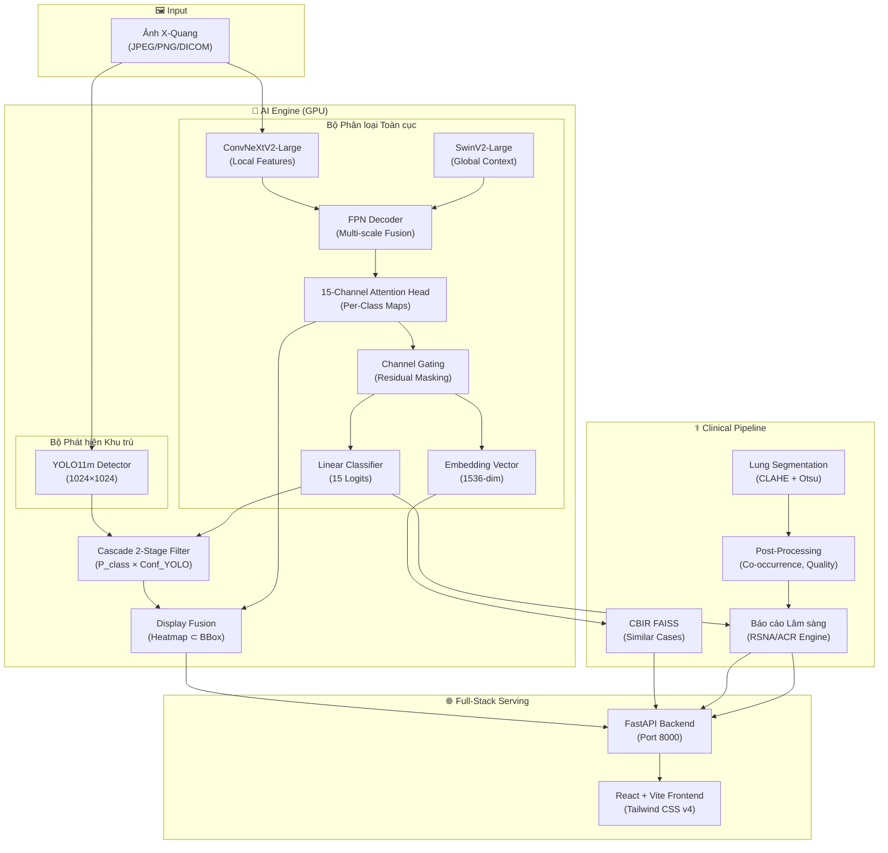

# 📋 BÁO CÁO TỔNG QUÁT DỰ ÁN CHEXNET PRO AI

> **Ngày lập**: 03/09/2026 | **Phạm vi**: Toàn bộ mã nguồn, 18 bản walkthrough (22/07 – 25/08), 14 phiên hội thoại (13/08 – 30/08)

---

## I. TỔNG QUAN DỰ ÁN

**CheXNet Pro AI** là hệ thống **CADx (Computer-Aided Diagnosis)** hỗ trợ chẩn đoán hình ảnh X-quang lồng ngực, phân loại **15 nhãn bệnh lý phổi** (14 bệnh + *No Finding*) với kiến trúc lai tiên tiến **Hybrid CNN-ViT**, phục vụ nghiên cứu khoa học (NCKH) đạt tiêu chuẩn thực nghiệm lâm sàng.

### Thông số chính

| Chỉ số | Giá trị |
|---|---|
| **AUROC tốt nhất** | **0.8651** (Epoch 12, Stage 2) |
| **Số bệnh phân loại** | 15 (14 bệnh lý + No Finding) |
| **Kích thước model chính** | 2.23 GB (`hybrid_model_light.pth`) |
| **YOLO detector** | 161 MB (`yolov11m.pt`) |
| **VRAM yêu cầu** | ~1.27 GB (CheXNet 1.12 GB + YOLO 154 MB) |
| **GPU đã test** | NVIDIA RTX 3050 Laptop |

---

## II. KIẾN TRÚC HỆ THỐNG



### Kiến trúc Mô hình Chi tiết

**HybridCNNViTModel** kết hợp 2 nhánh trích xuất đặc trưng:

1. **ConvNeXtV2-Large (CNN)**: Trích xuất đặc trưng cục bộ đa tầng
2. **SwinV2-Large (ViT)**: Nắm bắt ngữ cảnh toàn cục qua Self-Attention
3. **FPN Decoder**: Hòa trộn đặc trưng CNN (24×24) với ViT (12×12 → upsample) tạo attention map độ phân giải cao
4. **15-Channel Attention Head**: Mỗi bệnh có 1 attention map riêng biệt
5. **Channel Gating**: $\mathbf{F}'_k = \mathbf{F}_k + \alpha \cdot (\mathbf{F}_k \odot \mathbf{M}_k)$ với $\alpha \in [0, 0.8]$

---

## III. CẤU TRÚC DỰ ÁN & 23 TỆP CỐT LÕI

```
CheXNet/
├── main.py                          # CLI: Train / Resume / Test (TTA, Bootstrap CI, AUROC)
├── predict_single.py                # Dự đoán ảnh đơn + Heatmap + Bar chart
├── run_predict.py                   # Script mẫu chạy nhanh inference
├── requirements.txt                 # PyTorch 2.x, timm, scikit-learn, OpenCV...
│
├── Models/                          # ═══ Lõi Mô hình AI ═══
│   ├── Model.py                     # HybridCNNViTModel (ConvNeXtV2 + SwinV2 + FPN + Gating)
│   ├── TrainModel.py                # HybridTrainer: ASL, Dice, 2-Stage, EMA, DDP (~58KB)
│   ├── read_data.py                 # DatasetGenerator, HybridBatchSampler (NIH:VinDr = 3:1)
│   ├── config.py                    # TensorCoreConfig (auto GPU detection, AMP dtype)
│   ├── head_map.py                  # Trích xuất & overlay 15 attention maps
│   ├── checkpoint_utils.py          # load_checkpoint_safe, extract_state_dict
│   └── visualize.py                 # plot_training_progress (Loss, Dice, AUROC curves)
│
├── Finetune/                        # ═══ Fine-tune Tách biệt ═══
│   ├── main_finetune.py             # CLI fine-tune (LR giảm 3-5×, WD tăng 0.08)
│   └── TrainModel_finetune.py       # FinetuneTrainer (bỏ Stage 1, bật ColorJitter)
│
├── Backend/                         # ═══ FastAPI Server ═══
│   ├── main.py                      # /predict, /api/add_reference_case (~22KB)
│   ├── api.py                       # (trống — chưa refactor sang APIRouter)
│   ├── yolo_detector.py             # YOLODetector: Legacy/Hybrid mode, Cascade filter
│   ├── lung_segmentation.py         # Phân vùng phổi cổ điển, định vị giải phẫu
│   ├── post_processing.py           # cam_to_bboxes, co-occurrence 15×15, quality score
│   ├── report_generator.py          # Báo cáo lâm sàng Tiếng Việt (14 template bệnh)
│   └── cbir.py                      # FAISS IndexFlatIP (1536-dim), Dynamic Growth
│
├── Frontend/                        # ═══ React Web App ═══
│   ├── src/App.jsx                  # Dashboard chính: 4 tab, viewer kép, FAB chatbot
│   ├── src/components/ClinicalReport.jsx  # Báo cáo + form Dynamic Growth
│   ├── src/components/ClinicalReport.jsx  # Hiển thị báo cáo lâm sàng RSNA/ACR
│   ├── src/utils/radiologyMapper.js       # Đặc điểm X-quang chuẩn y tế 14 bệnh
│   └── src/utils/sampleData.js            # Ảnh mẫu SVG để test offline
│
├── Notebooks/
│   └── yolov11m_fixed.ipynb         # Train YOLO11m: WBF, Progressive, Cascade demo
│
├── Dataset/                         # train/val/test CSV splits
├── Database/                        # batch_download_zips.py (NIH dataset)
├── Trainedmodel/                    # hybrid_model_light.pth + yolov11m.pt
└── Results/                         # Biểu đồ đánh giá + ảnh dự đoán
```

---

## IV. NGĂN XẾP CÔNG NGHỆ

| Tầng | Công nghệ |
|---|---|
| **Deep Learning** | PyTorch 2.x, torchvision, timm (ConvNeXtV2, SwinV2) |
| **Object Detection** | Ultralytics YOLO11m |
| **Vector Database** | FAISS (IndexFlatIP, Cosine Similarity) |
| **Backend** | FastAPI, Uvicorn, Python-multipart |
| **Frontend** | React 18, Vite 5, Tailwind CSS v4 |
| **Clinical Intelligence** | Local Rule-based & Medical Evidence Synthesis |
| **Tối ưu GPU** | AMP (BF16/FP16), torch.compile, Gradient Checkpointing |
| **Phân tán** | DDP (torchrun), DataParallel fallback |

---

## V. CÁC ĐỘT PHÁ KỸ THUẬT THEN CHỐT

### 1. Huấn luyện 2 Giai đoạn (Two-Stage Training)

| | Giai đoạn 1 | Giai đoạn 2 |
|---|---|---|
| **Dữ liệu** | Chỉ VinDr-CXR (18k ảnh có bbox) | VinDr + NIH (tỷ lệ 1:3) |
| **Loss chính** | Dice + Focal Tversky (bbox GT) | ASL + Dice + Sparsity |
| **Mục tiêu** | Warm-up attention map | Phân loại toàn cục |
| **Điều kiện chuyển** | Dice < 0.65 & AUROC > 0.68 (2 epoch) | Early Stopping |

### 2. Asymmetric Loss (ASL) — Giải quyết Mất cân bằng Cực đoan

- Probability Shifting: `clip = 0.05` (dịch xác suất mẫu âm sang 0)
- Asymmetric Focusing: $\gamma_{\text{neg}} = 4$, $\gamma_{\text{pos}} = 0$
- Triệt tiêu >90% gradient từ True Negative dễ

### 3. Display Fusion — Giải quyết Xung đột Heatmap vs BBox

> [!IMPORTANT]
> Đây là giải pháp độc quyền giải quyết dứt điểm vấn đề bác sĩ bị bối rối khi heatmap (từ Classifier) và bounding box (từ YOLO) chỉ vào hai vùng khác nhau.

- **Có YOLO detection**: Heatmap chỉ render **bên trong** bounding box → viền xanh lá liền nét → độ tin cậy **CAO**
- **Không có YOLO detection**: Heatmap toàn ảnh → viền đứt nét cam từ Otsu contour → độ tin cậy **THẤP**

### 4. Cascade 2-Stage Filter

$$\text{Final\_Score} = P_{\text{CheXNet}}(disease) \times \text{Conf}_{\text{YOLO}}(box)$$

Ngưỡng động theo mức cấp cứu:

| Mức | Bệnh | Ngưỡng |
|---|---|---|
| **Critical** | Pneumothorax, Pneumonia | 0.05 |
| **High** | Cardiomegaly, Effusion, Consolidation | 0.10–0.12 |
| **Moderate** | Mass, Nodule, Infiltration | 0.25–0.35 |
| **Low** | Hernia, Pleural Thickening | 0.40–0.45 |

### 5. Uncertainty Weighting (Kendall & Gal 2018)

Tự động học trọng số $\log(\sigma^2)$ cho 2 task (ASL classification + Dice segmentation), thay thế cân chỉnh thủ công.

---

## VI. LỊCH SỬ PHÁT TRIỂN — BIÊN NIÊN 4 GIAI ĐOẠN

```mermaid
timeline
    title Lộ trình Phát triển CheXNet Pro AI (Jul-Aug 2026)
    section "Giai đoạn 1: Nền tảng (22/07–31/07)"
        22/07 : Contact Book App (Angular)
        23/07 : CheXNet ASL + EMA + TTA (AUROC 0.835→0.88+)
        25/07 : VSS Chat Platform Auth UI
        30/07 : Angular REST API (Reqres)
        31/07 : Vercel Postgres, Portfolio CV PDF
    section "Giai đoạn 2: Đột phá Thuật toán (05/08–08/08)"
        05/08 : FPN Decoder, Uncertainty Weighting, Multi-GPU DDP
        07/08 : 5 biểu đồ đánh giá chuẩn paper
        08/08 : Sửa lỗi Dice Loss hội tụ (augment sync bug)
    section "Giai đoạn 3: Sản phẩm hóa (11/08–13/08)"
        11/08 : FastAPI Backend + React Frontend
        12/08 : Cyber-Medical UI, Clinical Report Engine, CBIR FAISS
        12/08 : Git cleanup, Dynamic Growth
        13/08 : Fine-tune module tách biệt
    section "Giai đoạn 4: Hợp nhất Đa mô hình (17/08–25/08)"
        17/08 : Tích hợp YOLO11m + Cascade Filter
        17/08 : Sửa 4 bugs Backend (preprocessing mismatch)
        18/08 : Display Fusion, Hybrid YOLO notebook
        25/08 : Hardware Diagnostics Tool v2.0
```

### Chi tiết từng Giai đoạn

#### 🔵 Giai đoạn 1 — Khởi tạo Nền tảng (22/07 – 31/07)

- **23/07**: Bước ngoặt quan trọng đầu tiên — thay thế `BCEWithLogitsLoss` bằng **Asymmetric Loss (ASL)**, tích hợp **Model EMA** (decay 0.999) và **Test-Time Augmentation**. Mục tiêu: vượt AUROC 0.835 lên 0.88+.
- Song song phát triển kỹ năng web: Angular Contact Book, VSS Chat Auth, Vercel Postgres CMS, Portfolio PDF.

#### 🟢 Giai đoạn 2 — Đột phá Thuật toán & Vượt Khủng hoảng (05/08 – 08/08)

- **05/08**: Nâng cấp lớn nhất về kiến trúc — **FPN Decoder** tăng độ phân giải attention map (12×12 → 24×24), **Uncertainty Weighting** tự cân bằng multi-task loss, hỗ trợ **Multi-GPU DDP**.
- **08/08 (Khủng hoảng)**: Dice Loss kẹt ở 0.92, AUROC sụt. Truy vết phát hiện **3 lỗi chí mạng**:
  1. `mask_smooth=0.02` tạo trần kính cho Dice score
  2. `AttentionSparsityLoss` ép mô hình "bịa" tổn thương trên kênh âm tính
  3. **Bug cốt lõi**: Augmentation cắt mất tổn thương nhỏ khỏi khung hình nhưng nhãn vẫn = 1

#### 🟣 Giai đoạn 3 — Sản phẩm hóa & Tích hợp AI (11/08 – 13/08)

- **11/08**: Đóng gói thành Web App local (FastAPI + React Vite)
- **12/08**: Lột xác giao diện **Dark Cyber-Medical**, phát triển **Hệ thống Báo cáo Lâm sàng RSNA/ACR** (báo cáo chuyên sâu 5 phần), xây dựng **CBIR FAISS Dynamic Growth**
- **13/08**: Tách riêng module **Fine-tune** (LR giảm 3-5×, WD tăng, ASL nới lỏng)

#### 🔴 Giai đoạn 4 — Hợp nhất Đa mô hình (17/08 – 25/08)

- **17/08**: Tích hợp **YOLO11m** chạy song song, phát hiện & sửa **4 bugs chí mạng trong Backend** (preprocessing pipeline sai thứ tự gây "đoán bừa")
- **18/08**: Triển khai **Display Fusion** — giải quyết triệt để xung đột heatmap vs bbox. Viết lại notebook YOLO với **WBF**, **Progressive Training**, ánh xạ 14 class Hybrid.

---

## VII. BUGS QUAN TRỌNG ĐÃ PHÁT HIỆN & SỬA

| # | Bug | Nguyên nhân | Hậu quả | Fix |
|---|---|---|---|---|
| 1 | **Preprocessing mismatch** | `ToTensor` gọi trước `Resize/CenterCrop` trong Backend | Model "đoán bừa" | Thống nhất pipeline: PIL → Resize → CenterCrop → ToTensor → Normalize |
| 2 | **YOLO trùng GT boxes** | VinDr-CXR 3 bác sĩ dán nhãn → 3 box chồng chéo | Loss YOLO bị phạt nặng | Áp dụng WBF gộp thành 1 consensus box |
| 3 | **flipud=0.5 cho X-quang** | Lật dọc ảnh khiến tim/phổi lộn ngược | Vi phạm giải phẫu | Tắt `flipud=0.0` |
| 4 | **Dice Loss kẹt 0.92** | `mask_smooth=0.02` + SparsityLoss ép density target | Mô hình không hội tụ | Xóa smoothing, chuyển sang L1 sparsity |
| 5 | **Augmentation mất mask** | Crop/rotate đẩy tổn thương nhỏ ra ngoài, nhãn vẫn = 1 | Loss phạt vô lý | `valid_mask` kiểm tra diện tích mask sau augment |
| 6 | **GPU allocation phân mảnh** | `torch.load(map_location=device)` rồi mới đưa vào model CPU | Phân mảnh VRAM | Load CPU → `load_state_dict()` → `.to(device)` |

---

## VIII. API ENDPOINTS

| Method | Endpoint | Chức năng |
|---|---|---|
| `GET` | `/` | Health check (model_loaded, yolo_loaded, device) |
| `POST` | `/predict` | Chẩn đoán toàn diện: 15 bệnh, YOLO boxes, heatmap base64, vị trí giải phẫu, co-occurrence, báo cáo lâm sàng, CBIR |
| `POST` | `/api/add_reference_case` | Nạp ca bệnh mới vào FAISS (Dynamic Growth) |

---

## IX. TÍNH NĂNG FRONTEND

| Tab | Nội dung |
|---|---|
| **Phân tích X-Quang** | Viewer kép (DICOM gốc ↔ Heatmap), bảng 15 bệnh với thanh xác suất, YOLO lesion cards |
| **Báo cáo Lâm Sàng** | Báo cáo CheXNet AI (rule-based, tiếng Việt), form Dynamic Growth |
| **Báo cáo Lâm Sàng** | Báo cáo chuyên sâu 5 phần chuẩn RSNA/ACR (Kỹ thuật, Mô tả, Kết luận, Khuyến nghị) |
| **Cấu hình Hệ Thống** | Cấu hình FastAPI Backend Endpoint |
| **FAB Chatbot** | Trợ lý Y khoa AI tương tác, ngữ cảnh ca bệnh tự động |

---

## X. ĐÁNH GIÁ HIỆN TRẠNG

### ✅ Điểm hoàn thiện xuất sắc

1. **Kiến trúc mô hình** Hybrid CNN-ViT với FPN, Per-Class Gating, Uncertainty Weighting — giải quyết triệt để các vấn đề khó (mất cân bằng nhãn, attention collapse, multi-task balancing)
2. **Pipeline huấn luyện** 2 giai đoạn kết hợp NIH + VinDr-CXR với HybridBatchSampler, EMA, DDP, AMP
3. **Hệ thống song song** CheXNet (phân loại) + YOLO11m (định vị) + Cascade Filter + Display Fusion
4. **Full-stack serving** hoàn chỉnh FastAPI ↔ React, demo chạy mượt trên RTX 3050
5. **Clinical Intelligence**: Báo cáo y khoa tiếng Việt, CBIR Dynamic Growth, co-occurrence analysis, lung segmentation, anatomical localization

### ⚠️ Điểm cần hoàn thiện

| # | Hạng mục | Mức độ | Ghi chú |
|---|---|---|---|
| 1 | `Backend/api.py` trống | Thấp | Cần refactor endpoints sang APIRouter |
| 2 | FAISS index chưa pre-build | Trung bình | `Backend/data/` rỗng, cần chạy `build_faiss_index.py` |
| 3 | `optimal_thresholds.npy` | Thấp | Cần chạy Test mode để xuất, hiện fallback 0.5 |
| 4 | Dependencies Backend thiếu | Thấp | Cần bổ sung `faiss-cpu`, `ultralytics`, `uvicorn`, `fastapi` vào requirements |
| 5 | Docker deployment | Trung bình | Chưa có Dockerfile/docker-compose |
| 6 | Unit Tests | Trung bình | Chưa có test suite tự động |

---

## XI. ĐỀ XUẤT BƯỚC TIẾP THEO

### Ưu tiên cao
1. **Pre-build FAISS Index**: Chạy `build_faiss_index.py` trên tập train/val để CBIR hoạt động ngay từ đầu
2. **Chạy Test mode**: Xuất `optimal_thresholds.npy` và bộ biểu đồ đánh giá cho paper
3. **Hợp nhất requirements**: Gộp dependencies Backend + Root vào 1 file thống nhất

### Ưu tiên trung bình
4. **Refactor Backend**: Tách endpoints sang `api.py` với `APIRouter`
5. **Docker packaging**: Dockerfile cho Backend (FastAPI) + Frontend (Vite/Nginx)
6. **Viết paper/báo cáo NCKH**: Sử dụng biểu đồ từ `Results/` và kiến trúc đã hoàn thiện

### Ưu tiên thấp
7. **Progressive YOLO training**: Huấn luyện YOLO Hybrid 14-class với pseudo-labels từ CheXNet
8. **Weakly-supervised localization paper**: Khai thác 15-channel attention maps
9. **Clinically-calibrated uncertainty estimation**

---

> [!NOTE]
> Báo cáo này được tổng hợp từ việc phân tích **23 tệp mã nguồn**, đọc **18 bản walkthrough** (22/07–25/08/2026), và rà soát **14 phiên hội thoại** (13/08–30/08/2026). Dự án đã trải qua **4 giai đoạn phát triển** hoàn chỉnh từ nghiên cứu lý thuyết → thử nghiệm thuật toán → xử lý sự cố → sản phẩm hóa chuyên nghiệp.
