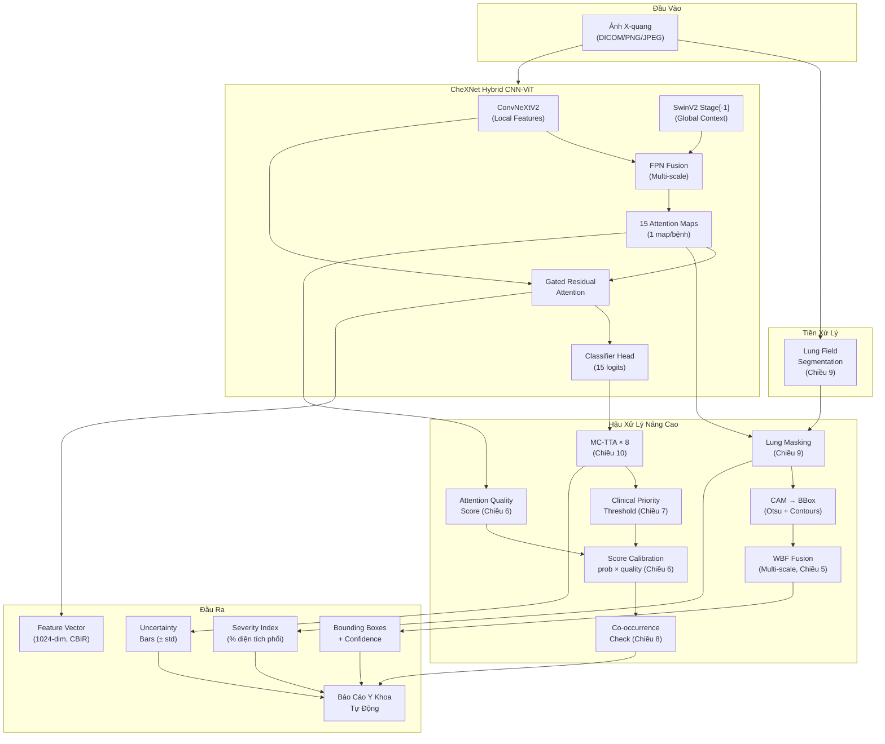

# Phân Tích Tích Hợp Nâng Cao: CheXNet × VinBigData Solutions

## Tổng Quan Hiện Trạng Dự Án

Dự án hiện tại là một hệ thống **Hybrid CNN-ViT (ConvNeXtV2 + SwinV2)** phân loại đa nhãn 15 bệnh lý phổi, đã được train trên dữ liệu **NIH Chest X-ray** kết hợp **VinDr-CXR** (có bounding box annotations). Mô hình đã train xong (checkpoint `hybrid_model_light.pth` ~2.2GB), có backend FastAPI serving và frontend React/Vite.

**Điểm mạnh sẵn có mà ít dự án Classification thông thường có:**
- 15 Attention Maps riêng biệt (1 map/bệnh) — không phải 1 heatmap chung
- Gated Residual Attention với per-class channel grouping
- Dice Loss + Focal Tversky đã train trên ground-truth bbox từ VinDr-CXR
- TTA (Test-Time Augmentation) tích hợp sẵn ở cả Backend lẫn Validation
- FPN multi-scale (stage[-2] + stage[-1]) cho phát hiện đa quy mô

---

## I. BỐN TRỤ CỘT GỐC (Tóm tắt)

| # | Trụ Cột | Ý tưởng chính |
|---|---------|---------------|
| 1 | **CAM-to-BBox + WBF** | Chuyển Attention Map → Bounding Box bằng Otsu/Contours, gom TTA bbox qua WBF |
| 2 | **Feature Extraction** | Trích vector 1024-dim (masked_features pooled) cho CBIR và đo severity |
| 3 | **Auto Report Generation** | Tạo báo cáo y khoa tự động bằng tiếng Việt |
| 4 | **2-Stage Cascade** | CheXNet Classifier → YOLO Detector (pipeline theo kiểu 1st Place VinBigData) |

---

## II. BẢY CHIỀU BỔ SUNG MỚI

### 🔬 Chiều 5: Multi-Scale Attention Fusion — Khai Thác FPN Đã Có

#### Vấn đề hiện tại
Trong [Model.py L129-136](file:///d:/temp/tempnckh/CheXNet/Models/Model.py#L129-L136), mô hình đã tính `fpn_features` (kết hợp coarse ViT features + higher-res CNN stage[-2]) để sinh `attention_map_hires`. Tuy nhiên khi inference, **chỉ dùng `attention_map_hires` duy nhất** — lãng phí thông tin coarse-level.

#### Giải pháp
Trích xuất **2 tầng attention** (high-res từ FPN và coarse từ ViT trực tiếp), sau đó dùng **multi-scale WBF**:

```python
# Pseudo-code: Multi-scale BBox extraction
def extract_multiscale_bboxes(model, image):
    logits, att_hires = model(image)         # att_hires: [1, 15, H_fpn, W_fpn]
    
    # Hack: trích att_coarse trước khi FPN (thêm hook hoặc sửa forward)
    att_coarse = model.attention_head_coarse(vit_features)  # [1, 15, H_coarse, W_coarse]
    
    bboxes_hires = cam_to_bbox(att_hires)    # Bắt tổn thương nhỏ (nốt, vôi hoá)
    bboxes_coarse = cam_to_bbox(att_coarse)  # Bắt tổn thương lan toả (đông đặc, tràn dịch)
    
    # WBF gộp 2 scale → bbox vừa chính xác vừa đầy đủ
    final_bboxes = weighted_boxes_fusion([bboxes_hires, bboxes_coarse], weights=[0.6, 0.4])
```

#### Tại sao tạo khác biệt?
- **Giải nhì VinBigData** dùng 2 giai đoạn độ phân giải ($1024 \to 2048$) để bắt vi tổn thương. Ta đạt hiệu ứng tương tự nhờ FPN sẵn có mà **không cần train lại ở resolution cao hơn**.
- Tổn thương như **Calcification** (nốt vôi hoá nhỏ vài mm) cần high-res attention, nhưng **Pleural Effusion** (tràn dịch chiếm cả thuỳ phổi) lại cần coarse-level để ôm đủ diện tích.

---

### 🧠 Chiều 6: Attention-Guided Confidence Calibration — Học Từ 1st Place

#### Ý tưởng cốt lõi (từ đội vô địch)
Đội hạng nhất VinBigData dùng **Image-level Classifier** để điều chỉnh confidence score của Detector. Dự án CheXNet đã CÓ SẴN cơ chế tương đương mà chưa khai thác hết:

- `logits` → xác suất phân loại cấp ảnh (tương đương Image Classifier)
- `attention_map` → thông tin định vị (tương đương Detector output)

#### Giải pháp: Attention Quality Score

```python
def compute_attention_quality(att_map_2d, threshold=0.3):
    """Đo chất lượng attention map — vùng kích hoạt có rõ ràng không?"""
    high_activation = (att_map_2d > threshold).float()
    
    # 1. Tập trung (Concentration): tỉ lệ diện tích kích hoạt cao
    concentration = high_activation.mean()
    
    # 2. Tương phản (Contrast): chênh lệch mean giữa vùng cao vs thấp
    if high_activation.sum() > 0:
        mean_high = att_map_2d[high_activation.bool()].mean()
        mean_low = att_map_2d[~high_activation.bool()].mean() if (~high_activation.bool()).sum() > 0 else 0
        contrast = mean_high - mean_low
    else:
        contrast = 0
    
    # 3. Sharpness: entropy thấp = attention rõ ràng (gần 0 hoặc 1)
    eps = 1e-6
    a = att_map_2d.clamp(eps, 1-eps)
    entropy = -(a * torch.log(a) + (1-a) * torch.log(1-a)).mean()
    sharpness = 1 - entropy / 0.693  # normalise (max entropy of Bernoulli = ln2)
    
    return concentration, contrast, sharpness
```

**Ứng dụng**: Khi attention map cho bệnh X có `concentration` rất thấp (lan toả khắp nơi) hoặc `contrast` thấp (không phân biệt vùng bệnh vs nền), thì **giảm confidence score** dù xác suất phân loại cao → giảm False Positive.

> [!IMPORTANT]
> Đây chính xác là tư tưởng **Score Calibration** `Final_Score = P_classifier × Quality_attention` mà đội hạng nhất sử dụng, nhưng ta làm **TRONG CÙNG 1 model** thay vì cần 2 model riêng biệt.

---

### 📊 Chiều 7: Per-Class Optimal Threshold + Recall Maximization

#### Bài học từ 1st Place (Metric Exploitation)
Đội vô địch phát hiện mAP\@0.4 không phạt nặng Bounding Box thừa → hạ threshold để tối đa Recall.

#### Áp dụng vào CheXNet
Trong [predict_single.py L196-203](file:///d:/temp/tempnckh/CheXNet/predict_single.py#L196-L203), hệ thống đã hỗ trợ `optimal_thresholds` từ file `Results/optimal_thresholds.npy`. Tuy nhiên:

1. **Chưa tối ưu ngưỡng theo mục đích y khoa**: Threshold hiện tại optimize F1-score (cân bằng Precision-Recall). Trong y tế, **bỏ sót bệnh nguy hiểm hơn báo nhầm nhiều** → cần optimize cho **Recall ≥ 0.95** rồi mới tối ưu Precision.

2. **Chưa có class-specific strategy**: Một số bệnh cần threshold cực thấp (Pneumothorax — tràn khí màng phổi, bỏ sót có thể tử vong) vs một số bệnh cho phép threshold cao hơn (Pleural Thickening — thường lành tính).

```python
# Chiến lược threshold theo mức độ nguy hiểm lâm sàng
CLINICAL_PRIORITY = {
    'Pneumothorax':  'critical',   # Threshold thấp, Recall ≥ 0.98
    'Pneumonia':     'critical',   # Threshold thấp, Recall ≥ 0.95
    'Cardiomegaly':  'high',       # Threshold trung bình, Recall ≥ 0.90
    'Effusion':      'high',
    'Mass':          'high',
    'Nodule':        'high',       # Nốt mờ → cần tầm soát ung thư
    'Consolidation': 'moderate',
    'Infiltration':  'moderate',
    'Atelectasis':   'moderate',
    'Edema':         'moderate',
    'Emphysema':     'low',
    'Fibrosis':      'low',
    'Pleural_Thickening': 'low',
    'Hernia':        'low',
}

TARGET_RECALL = {
    'critical': 0.98,
    'high':     0.93,
    'moderate': 0.88,
    'low':      0.80,
}
```

---

### 🏥 Chiều 8: Tương Quan Bệnh Lý (Disease Co-occurrence Graph)

#### Thực tế y khoa
Các bệnh phổi thường **xuất hiện đồng thời** theo pattern có ý nghĩa lâm sàng:
- **Cardiomegaly** → thường kèm **Effusion** (suy tim → tràn dịch)
- **Pneumonia** → thường kèm **Consolidation** + **Infiltration**
- **Mass** → thường kèm **Atelectasis** (khối u chèn ép → xẹp phổi)

#### Ứng dụng: Post-hoc Consistency Check

```python
# Ma trận tương quan bệnh (học từ training data)
CO_OCCURRENCE = compute_co_occurrence_matrix(train_labels)  # [15, 15]

def consistency_adjustment(probs, co_occurrence, alpha=0.15):
    """Điều chỉnh xác suất dựa trên tương quan bệnh đã biết."""
    adjusted = probs.copy()
    for i in range(len(probs)):
        if probs[i] > 0.5:  # Bệnh chính đã phát hiện
            for j in range(len(probs)):
                if i != j:
                    # Boost bệnh thường đi kèm
                    boost = co_occurrence[i, j] * alpha
                    adjusted[j] = min(1.0, adjusted[j] + boost * probs[i])
    return adjusted
```

**Nhận xét trong báo cáo**:
> *"Phát hiện Cardiomegaly (p=0.89) kèm Effusion (p=0.72). Hai tổn thương này có tương quan lâm sàng cao (r=0.65) — gợi ý Suy tim sung huyết. Đề nghị Siêu âm tim Doppler."*

---

### 🫁 Chiều 9: Lung Field Segmentation — Baseline Giải Phẫu

#### Vấn đề
Attention map hiện tại đôi khi kích hoạt ở vùng **ngoài phổi** (xương sườn, cơ hoành, catheter, text annotation trên phim). Điều này tạo ra BBox sai vị trí và gây mất tin tưởng từ bác sĩ.

#### Giải pháp
Thêm bước **Lung Field Masking** trước khi chuyển Attention → BBox:

1. Dùng mô hình segmentation nhẹ (U-Net hoặc pretrained trên JSRT/Montgomery) để segment vùng phổi.
2. Nhân attention map với lung mask → chỉ giữ activation trong vùng phổi.

```python
def apply_lung_mask(attention_map, lung_mask):
    """Lọc attention chỉ trong vùng phổi."""
    # lung_mask: [H, W] binary (1 = phổi, 0 = ngoài phổi)
    # attention_map: [15, H, W]
    
    # Một số bệnh CÓ THỂ ở ngoài phổi (Cardiomegaly → tim, Hernia)
    NON_LUNG_DISEASES = {'Cardiomegaly', 'Hernia'}
    
    for i, disease in enumerate(CLASS_NAMES):
        if disease not in NON_LUNG_DISEASES and disease != 'No Finding':
            attention_map[i] *= lung_mask
    
    return attention_map
```

**Lợi ích kép**:
- BBox chính xác hơn (không ra ngoài phổi)
- Tính được **tỉ lệ diện tích tổn thương / diện tích phế trường** chính xác (Chiều 2 ở trên)

---

### 📈 Chiều 10: Uncertainty Estimation — Đo Độ Tin Cậy Dự Đoán

#### Vấn đề
Hiện tại mô hình chỉ trả về **1 con số xác suất** cho mỗi bệnh. Bác sĩ không biết mô hình **tự tin bao nhiêu** về dự đoán đó. Xác suất 0.75 có thể đến từ 10 lần TTA đều cho kết quả ~0.75 (rất tin cậy), hoặc từ 5 lần cho 0.95 và 5 lần cho 0.55 (rất dao động).

#### Giải pháp: MC-TTA (Monte Carlo Test-Time Augmentation)

Backend đã có TTA 2 lần (gốc + lật). Mở rộng thành **N lần augmentation** và tính **phương sai** để đo uncertainty:

```python
def predict_with_uncertainty(model, image_tensor, n_augments=8):
    """Chạy N lần TTA khác nhau, tính mean ± std cho mỗi bệnh."""
    augments = [
        lambda x: x,                              # Gốc
        lambda x: torch.flip(x, dims=[3]),         # Lật ngang
        lambda x: torch.flip(x, dims=[2]),         # Lật dọc
        lambda x: torch.rot90(x, 1, [2, 3]),       # Xoay 90°
        # ... thêm crop, scale, etc.
    ]
    
    all_probs = []
    all_att_maps = []
    for aug_fn in augments[:n_augments]:
        with torch.no_grad():
            logits, att = model(aug_fn(image_tensor))
            all_probs.append(torch.sigmoid(logits))
            # Đảo ngược augmentation cho attention map
            all_att_maps.append(inverse_augment(att, aug_fn))
    
    probs_stack = torch.stack(all_probs)        # [N, 1, 15]
    mean_probs = probs_stack.mean(dim=0)        # [1, 15]
    std_probs = probs_stack.std(dim=0)          # [1, 15] — uncertainty!
    
    # Attention maps: lấy mean sau khi đảo ngược augmentation
    mean_att = torch.stack(all_att_maps).mean(dim=0)  # [1, 15, H, W]
    
    return mean_probs, std_probs, mean_att
```

**Hiển thị trên báo cáo**:
- Effusion: **72% ± 3%** (tin cậy cao ✅)
- Nodule: **58% ± 18%** (không chắc chắn ⚠️ — cần bác sĩ xác nhận)

---

### 🔗 Chiều 11: Liên Kết Dữ Liệu Đào Tạo — Leverage Cả NIH Lẫn VinDr

#### Phát hiện quan trọng từ codebase

Trong [read_data.py](file:///d:/temp/tempnckh/CheXNet/Models/read_data.py), dữ liệu đã được chia làm 2 nguồn:
- **NIH Chest X-ray**: ~112K ảnh, chỉ có nhãn phân loại (không có bbox)
- **VinDr-CXR**: có bbox annotations, nhưng nhãn bệnh **KHÁC HỆ** với NIH

Trong [HybridBatchSampler](file:///d:/temp/tempnckh/CheXNet/Models/read_data.py#L327-L379), tỉ lệ VinDr:NIH = 1:3. Đây là chiến lược hay nhưng có thể cải thiện:

#### Giải pháp: Cross-Source Knowledge Transfer
1. **Pseudo-Label BBox cho NIH**: Dùng mô hình đã train (attention maps) để sinh pseudo-bbox cho 75% ảnh NIH → thêm dữ liệu Dice training.
2. **Progressive Self-Training**: 
   - Epoch 1-10: Dice chỉ trên VinDr (bbox thật)
   - Epoch 11+: Dice trên VinDr + top-30% ảnh NIH có pseudo-bbox confidence cao nhất
   - Lặp lại: mô hình tốt hơn → pseudo-bbox tốt hơn → Dice tốt hơn

> [!TIP]
> Chiến lược này giống **Semi-Supervised Learning** — một trong những kỹ thuật mà các đội Top VinBigData sử dụng nhưng không công bố chi tiết.

---

## III. BẢNG TỔNG HỢP: LỢI THẾ CẠNH TRANH

| Chiều | Nguồn cảm hứng | Lợi thế của CheXNet Hybrid | Nỗ lực triển khai |
|:---:|:---|:---|:---:|
| 1 | VinBigData 2nd Place (WBF) | Attention Maps 15 kênh sẵn có → bbox/bệnh riêng | ⭐⭐ |
| 2 | Feature Extraction / CBIR | 1024-dim vector đã pooled qua Residual Attention | ⭐⭐ |
| 3 | Auto Report Generation | Kết hợp prob + bbox + severity → nhận xét y khoa | ⭐⭐⭐ |
| 4 | VinBigData 1st Place (2-Stage) | CheXNet Classifier + YOLO Detector cascade | ⭐⭐⭐⭐ |
| **5** | VinBigData 2nd Place (Multi-res) | FPN sẵn có → multi-scale bbox không cần retrain | ⭐⭐ |
| **6** | VinBigData 1st Place (Score Calib) | Attention quality × classification prob trong 1 model | ⭐ |
| **7** | VinBigData 1st Place (Recall Max) | Per-class clinical priority threshold | ⭐ |
| **8** | Y khoa lâm sàng | Disease co-occurrence → diagnostic reasoning | ⭐⭐ |
| **9** | Anatomical prior knowledge | Lung mask → lọc bbox ngoài phổi | ⭐⭐ |
| **10** | Bayesian Deep Learning | MC-TTA → đo uncertainty mỗi dự đoán | ⭐ |
| **11** | Semi-supervised Learning | Pseudo-label bbox cho 112K ảnh NIH | ⭐⭐⭐ |

> Nỗ lực: ⭐ = dưới 1 ngày, ⭐⭐ = 1-3 ngày, ⭐⭐⭐ = 1 tuần, ⭐⭐⭐⭐ = 2+ tuần

---

## IV. KIẾN TRÚC TỔNG THỂ SAU TÍCH HỢP



---

## V. ƯU TIÊN TRIỂN KHAI (Đề xuất thứ tự)

### Phase 1 — Quick Wins (1-2 tuần)
Những chiều có nỗ lực thấp nhưng tạo ấn tượng mạnh:

| Ưu tiên | Chiều | Lý do |
|:---:|:---|:---|
| 🥇 | **6. Attention Quality Score** | Chỉ thêm ~30 dòng code hậu xử lý, không cần retrain |
| 🥈 | **7. Clinical Threshold** | Thay file `optimal_thresholds.npy` bằng strategy mới |
| 🥉 | **10. Uncertainty (MC-TTA)** | Mở rộng TTA sẵn có từ 2→8 lần, thêm std output |
| 4 | **1. CAM-to-BBox cơ bản** | Thay `cv2.circle` bằng `cv2.findContours` + `cv2.boundingRect` |

### Phase 2 — Core Differentiation (2-4 tuần)
Những chiều tạo sự khác biệt chất lượng lớn:

| Ưu tiên | Chiều | Lý do |
|:---:|:---|:---|
| 5 | **5. Multi-scale WBF** | Khai thác FPN sẵn có, cần sửa `forward()` trả thêm output |
| 6 | **8. Disease Co-occurrence** | Tính ma trận tương quan từ training data, thêm vào report |
| 7 | **3. Auto Report** | Kết hợp tất cả outputs thành báo cáo có cấu trúc |
| 8 | **2. Feature Extraction + CBIR** | Cần build vector database, UI tìm ảnh tương tự |

### Phase 3 — Advanced (4+ tuần)
Những chiều cần nỗ lực nghiên cứu:

| Ưu tiên | Chiều | Lý do |
|:---:|:---|:---|
| 9 | **9. Lung Segmentation** | Cần train/load thêm 1 model segmentation |
| 10 | **11. Pseudo-label + Self-training** | Cần retrain model, thời gian GPU đáng kể |
| 11 | **4. CheXNet + YOLO Cascade** | Cần train YOLOv8 riêng trên VinBigData detection |

---

## VI. KHẢ NĂNG MỞ RỘNG CHO NGHIÊN CỨU KHOA HỌC

Nếu dự án hướng tới **bài báo khoa học / luận văn**, các chiều trên có thể tổ chức thành **3 đóng góp (contributions)**:

1. **Contribution 1 — Weakly-Supervised Localization từ Classification Model**:
   Chứng minh rằng per-class attention maps kết hợp WBF đạt mAP@0.4 tương đương (hoặc gần) các mô hình detection chuyên dụng, mà không cần annotation bbox nặng nề (chỉ cần image-level labels cho phần lớn dữ liệu).

2. **Contribution 2 — Clinically-Calibrated Uncertainty-Aware Prediction**:
   Kết hợp Attention Quality Score + MC-TTA uncertainty + Clinical Priority Threshold để tạo ra hệ thống không chỉ nói "có bệnh X" mà còn nói "tin cậy bao nhiêu" và "cần hành động gì".

3. **Contribution 3 — Automated Diagnostic Report Generation**:
   Pipeline end-to-end từ ảnh X-quang → Báo cáo y khoa có cấu trúc, bao gồm chẩn đoán, định vị, định lượng, và khuyến nghị — tích hợp disease co-occurrence reasoning.

> [!NOTE]
> Tất cả các chiều đều **KHÔNG yêu cầu train lại model từ đầu** (trừ Chiều 11). Checkpoint `hybrid_model_light.pth` hiện tại đã đủ để triển khai Phase 1 và Phase 2 hoàn toàn ở tầng inference/post-processing.
